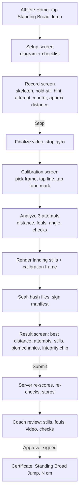

# PRAMAAN — Standing Broad Jump (SBJ): Test Spec & Implementation Plan

> **Purpose:** Add the Standing Broad Jump as a third AI-scored test (after Vertical Jump and Sit-ups), measured to within ±2 cm, with SAI-style foul rules, physics-based integrity checks, and a built-in accuracy-validation workflow.
> **Audience:** Coding agents and the team. Read the whole file before writing code.
> **Level:** Hackathon prototype. Accurate and demonstrable, not production-hardened.
> **Builds on:** `Build_Description.md` (current build) and `PRAMAAN_Role_Workflow_Spec.md` (athlete/coach/server workflow).

---

## 0. Rules for the agent (read first)

1. **Do not write code until you have produced `PLAN_SBJ.md`.** It must map every file/class named here to the real file in the repo (names below are best guesses), list conflicts with existing code, and propose resolutions. Wait for approval.
2. **Do not change the behaviour of Vertical Jump or Sit-ups.** Run all existing tests before and after each phase.
3. `:core` stays pure Kotlin: no `android.*`, no system clock. Time comes only from frame timestamps. Every number that affects a result lives in `BroadJumpParams` (§5.9).
4. Phone and server must run **the same `:core` code** on the same inputs. Any difference beyond tolerance (§10.4) is an integrity flag.
5. Reuse existing pieces: `PoseTrack`/`PoseFrame`, `ParabolaFit`, `CanonicalJson`, `IntegrityEngine`, `Sealer`, `DeviceKey`, the coach review flow, certificate issuance. Extend them by test type; don't fork them.
6. **SAI's own rule text for this test was not available when this was written.** The rules in §3.3 follow general standing-long-jump practice. Keep every rule configurable and mark open questions in `PLAN_SBJ.md` for a PE coach to confirm.
7. Ask before changing a fixed decision in §1.

---

## 1. Summary and fixed decisions

| # | Decision | Why |
|---|---|---|
| D1 | Measure **line → rearmost ground contact after landing**, in cm | Official definition: from the take-off line to the nearest point of contact |
| D2 | **Marker calibration is primary**: a tape measure laid along the jump path with 0 at the take-off line; the coach taps the line and a known mark (default 200 cm) | Matches SAI's own setup (tape with zero at the line). Height-based scaling alone cannot reach ±2 cm |
| D3 | Calibration taps happen **after recording, on a frame of the recorded video**, and are signed into the manifest | Ties the scale to the exact video; no camera-moved-after-calibration problem; taps can't be edited after sealing |
| D4 | **Height-only scale** (athlete's registered height) is computed as a cross-check and as a fallback mode. Fallback results are `FLAGGED` (`CALIB_APPROX`) and cannot be coach-approved or certified | Honest: approximate mode is for practice, not certification |
| D5 | Up to **3 attempts in one continuous video**, best valid attempt wins | SAI note: continuous single take per test; best of 2–3 |
| D6 | Fouls: toes over line, step/hop start, one-foot take-off (invalidate); backward fall (measure to that contact point, note only) | See §3.3 |
| D7 | Integrity checks reuse C1/C2/C4; **C3 becomes "Horizontal consistency"**; new **C5 "Calibration agreement"** | Slowed/sped/spliced video breaks gravity and horizontal-motion consistency |
| D8 | No projectile-range formula as a validator (point-mass `v²sin2θ/g` fails for real jumpers); angle is shown as feedback only | Would wrongly fail honest jumps |
| D9 | Accuracy is **proved with a tape-measure validation study** built into the dashboard (§12) | The judges' question |

---

## 2. SAI alignment and what "on par" means

- SAI's concept note asks for a **contactless method** to measure horizontal jump distance with a mobile device that **handles multiple attempts, identifies the best result, and minimises assessor intervention**.
- Its AI benchmark list says **jump detection within ±2 cm**. It is not specific to this test; applying it here is our interpretation. Say so.
- SAI's talent-identification protocol sets the test up with a floor line and a measuring tape whose zero is at that line, which is exactly our calibration model.
- Videos must be a **continuous, unedited single take, 720p+, MP4**, tied to athlete ID, with a signed declaration. The existing seal + coach approval covers this.

**Internal accuracy targets** (ours, not SAI's): mean absolute error ≤ 1.5 cm, ≥ 90% of attempts within ±2 cm, ≥ 98% within ±3 cm, foul recall ≥ 85% on staged fouls, false-foul rate ≤ 5% on clean jumps. Report whatever is measured, including misses.

---

## 3. Test protocol

### 3.1 Physical setup

| Item | Spec |
|---|---|
| Surface | Flat, non-slip, same level for take-off and landing, ≥ 4 m clear forward of the line |
| Take-off line | Tape or chalk line, ~5 cm wide, perpendicular to the jump direction |
| Tape measure | Laid flat along the jump path, **0 cm at the front edge of the take-off line** (the edge toward the landing area), running forward ≥ 2.5 m, taped down |
| Phone | Landscape, side-on to the jump path, **3–4 m** from the tape, lens at ~0.5–1 m height, on a tripod or propped on a bag/books; must not move during recording |
| Framing | From ~0.5 m behind the line to ~3 m beyond it; athlete 45–70% of frame height; the whole tape from 0 to the chosen mark visible |
| Camera | Rear camera, 720p+, 60 fps if supported else 30 fps. Ultra-wide lens is fine if it keeps the tape near the middle 70% of the frame |
| Athlete | Registered height in profile; shoes on (record which); bare floor contrast preferred |
| Light | Evenly lit, no strong backlight |

### 3.2 Athlete procedure (per attempt)

1. Stand with both toes behind the line, feet roughly shoulder-width, **still for about 1 second**.
2. Swing the arms and bend the knees; take off with **both feet together**; land on both feet.
3. Hold the landing for about 1 second, then step forward out of the landing area.
4. Walk back, stand still again, repeat. Up to 3 attempts, all in the same recording.

### 3.3 Rules (all configurable, defaults below, confirm with a coach)

| Code | Rule | Effect | Default |
|---|---|---|---|
| `TOES_OVER_LINE` | Toes cross the front edge of the line before take-off | Attempt invalid | On |
| `STEP_OR_HOP` | A foot moves > 5 cm before take-off, or the feet leave the ground in a hop before the main jump | Attempt invalid | On |
| `ONE_FOOT_TAKEOFF` | Feet leave the ground > 60 ms apart (and > 2.5 frames apart) | Attempt invalid | On; if it false-flags > 5% of clean jumps in validation, set to note-only |
| `FALL_BACK` (note) | A hand or the hips touch the ground behind the rearmost heel after landing | Not a foul. Distance is measured to that contact point | Note |
| `NO_JUMP` | Not enough flight or forward travel to count as a jump | Not an attempt; ignored | — |
| `EXTRA_ATTEMPTS_IGNORED` (note) | More than `maxAttempts` jumps in the video | Only the first 3 count | Note |

Distance is measured from the **front edge of the line** to the **rearmost ground contact** (normally the back of the rearmost heel) and recorded to 0.1 cm, shown in whole cm.

---

## 4. End-to-end flow



Everything up to the Result screen works **offline**. Upload, coach review and certificate follow the existing role workflow unchanged, with `test = BROAD_JUMP`.

---

## 5. Measurement method

### 5.1 Coordinates and units

- MediaPipe landmarks are normalized `[0,1]` in the **upright** analysis image. Convert to pixels with the analysis frame size `(W, H_img)` stored in the manifest: `px = (x·W, y·H_img)`.
- Landmark indices used: NOSE 0; L/R EYE 2/5; L/R SHOULDER 11/12; L/R WRIST 15/16; L/R HIP 23/24; L/R KNEE 25/26; L/R ANKLE 27/28; L/R HEEL 29/30; L/R FOOT_INDEX (toe) 31/32.
- A point is used only if `visibility ≥ minLandmarkVisibility` (0.5).
- The video must be **landscape**. The jump axis should be within ±10° of the image horizontal (warn at > 10°, block sealing at > 20°).

### 5.2 Calibration (`GroundCalibration`)

The coach taps two points on a frame of the recorded video (§11.3):

- `L` = front edge of the take-off line, on the tape's 0 mark.
- `M` = a known mark on the tape, `markerCm` from the chips {100, 150, 200, 250, 300}, default 200.

Define in pixel space:

```
axis  e = (M − L) / |M − L|                (points forward, away from the line)
scale s = markerCm / |M − L|               (cm per pixel along the jump axis)
forwardCm(P) = dot(P − L, e) · s           (0 at the line, positive ahead)
upCm(P)      = (groundYpx − P.y) · s       (height above the floor)
```

`groundYpx` comes from the athlete's stance (§5.4). Perspective across the jump path is ignored; the tape should lie along the athlete's foot path, so ground points and the tape are at the same depth.

**Height-based scale (cross-check and fallback).** From a stance window:

```
bodyPx  = (pixel distance mid-eye → mid-heel) / eyeHeightRatio     // eyeHeightRatio = 0.936
sHeight = athleteHeightCm / bodyPx                                  // cm per pixel
scaleDiffPct = 100 · |s − sHeight| / s
```

**Modes**

| Mode | Taps | Scale used | Certifiable |
|---|---|---|---|
| `MARKER` | line + marker | `s` | Yes |
| `HEIGHT_ONLY` | line only; axis = image horizontal, direction from the stance toward the line | `sHeight` | **No** (`FLAGGED`, `CALIB_APPROX`) |

In `MARKER` mode the analyzer also computes `distanceHeightOnlyCm` for every attempt so the validation study can compare both modes.

### 5.3 Pipeline overview (`BroadJumpAnalyzer.analyze`)

```
PoseTrack ──► signals ──► bootstrap bodyPx/groundY ──► find flights ──► per flight:
   stance window → fouls → landing contact → distance → biomechanics → physics fit
──► BroadJumpResult (attempts, best, notes) ──► integrity checks C2, C3, C5 ──► manifest
```

### 5.4 Signals and bootstrap

1. Smooth landmark coordinates with a 3-frame median (kills single-frame spikes); keep timestamps in ns.
2. **Robust body scale:** `bodyPx0` = 80th percentile, over frames where eyes and heels are visible, of `eyeHeelPx / eyeHeightRatio`. (Standing frames dominate; crouched and tucked frames are shorter.)
3. **Ground:** `groundYpx` = median of `max(y of heels and toes)` over still stance windows (§5.5); per-attempt re-estimate; if it differs from the first by > 2% of `bodyPx`, add note `GROUND_DRIFT`.
4. `hipC` = midpoint of landmarks 23 and 24; `hipSpeed` = |d(hipC)/dt| over a 5-frame window, in `bodyPx` per second.

### 5.5 Finding attempts

1. `lowestFootUp(t) = groundY − max(y of landmarks 29, 30, 31, 32)`. A frame is **airborne** when `lowestFootUp > liftThrBody · bodyPx` (0.03).
2. A **flight** is a maximal run of airborne frames with duration ≥ `minFlightS` (0.28 s), ≤ `maxFlightS` (1.2 s), and forward hip travel ≥ `minHipTravelCm` (30 cm). Anything else is ignored (`NO_JUMP`).
3. **Take-off time `tTO`** and **touchdown time `tTD`:** linear interpolation of the crossings of `lowestFootUp` through the threshold, before and after the run.
4. **Stance window** for a flight: scan backwards from take-off for the last window ≥ `standStillMinS` (0.4 s) where `hipSpeed < stillSpeedBody` (0.15 body/s). Stance = that window. `prepStart` = first time after it where `hipSpeed` exceeds the threshold. If no still window exists within 4 s before take-off, use the global bootstrap values and add note `STANCE_NOT_STILL`.
5. From the stance window take: `bodyPx`, `groundYpx`, each foot's toe and heel forward position (`forwardCm`), and `stanceToeU = max(toeL, toeR)` forward position (median over the window).
6. Only the first `maxAttempts` flights count; the rest add note `EXTRA_ATTEMPTS_IGNORED`.

### 5.6 Foul detection (per flight)

| Foul | Computation |
|---|---|
| `TOES_OVER_LINE` | `max(forwardCm of both toes)` over `[prepStart, tTO]` > `lineTolCm` (3.0 cm). Also hard calibration error if `stanceToeU > stanceAheadErrorCm` (20 cm): "line/marker taps look reversed" |
| `STEP_OR_HOP` | (a) either toe's forward position moves > `stepTolCm` (5.0 cm) from its stance median during `[prepStart, tTO − 2 frames]`; or (b) any airborne frames (both feet off) occur in `[prepStart, tTO − 2 frames]` |
| `ONE_FOOT_TAKEOFF` | Per-foot toe-off time = first time that toe rises > `liftThr` above its own stance baseline at the final take-off. Foul if `|tL − tR| > max(60 ms, 2.5·frameDt)`. Needs both toes visible, else skip |

### 5.7 Landing contact and distance

1. **Landing window:** `[tTD, tTD + landingWindowS]` (0.6 s). A heel is **grounded** when `|y − groundYpx| ≤ groundTolBody · bodyPx` (0.03). Take each heel's forward position over grounded frames, 3-frame median filtered. `uHeelRear` = the minimum (rearmost) over both heels and the window. If one heel's visibility is low use the other and add note `HEEL_OCCLUDED`.
2. **Fall-back contacts** over `[tTD, tTD + fallWindowS]` (0.9 s): a wrist is in contact when `y ≥ groundY − wristContactBody·bodyPx` (0.08); a hip when `y ≥ groundY − hipContactBody·bodyPx` (0.15). If such a point's forward position is more than `fallBackMinCm` (2 cm) behind `uHeelRear`, the contact is `uHeelRear := that point` and note `FALL_BACK` is added with the contact type.
3. **Distance:** `distanceCm = uContactRear − heelOffsetCm`. `heelOffsetCm` is a single tuned constant that absorbs the offset between MediaPipe's heel landmark and the back of the real heel and the small downward bias of taking a minimum over noisy frames (§12.5). Default 0.0 until tuned.
4. `valid = no invalidating foul`. Invalid attempts still get a computed distance (shown greyed, excluded from best).
5. **Best** = max `distanceCm` over valid attempts. No valid attempt → `best = null`, status `NO_VALID_ATTEMPT`.

### 5.8 Biomechanics (shown to the athlete; not used for validity)

| Metric | Computation |
|---|---|
| Flight time | `tTD − tTO` (s) |
| Take-off angle | Linear fit of hip `(forward, up)` over the first 0.12 s after `tTO`; `atan2(vUp, vForward)` in degrees |
| Take-off speed | `sqrt(vForward² + vUp²)` in m/s |
| Knee dip | Minimum hip–knee–ankle angle (near-side leg) in `[prepStart, tTO]` |
| Arm swing index | `max over [prepStart, tTO + 0.1 s]` of `(wristUp − shoulderUp) / torsoLenPx`; positive means wrists above shoulders |
| Landing reach | `(rear heel forward − hip forward at tTD) / heightCm`; small values mean landing with the feet under the hips |
| Hip travel | `forwardCm(hip at tTD) − forwardCm(hip at tTO)` |

**Feedback (one line, first rule that matches):**

| Condition | Key |
|---|---|
| Knee dip > 130° | `fb_bj_deeper_dip` |
| Arm swing index < 0.0 | `fb_bj_swing_arms` |
| Take-off angle < 22° | `fb_bj_launch_higher` |
| Take-off angle > 50° | `fb_bj_launch_flatter` |
| Landing reach < 0.2 | `fb_bj_reach_forward` |
| otherwise | `fb_bj_good` |

Do not describe any angle as "optimal". Thresholds are defaults to tune.

### 5.9 `BroadJumpParams` (defaults)

| Param | Default | Param | Default |
|---|---|---|---|
| `eyeHeightRatio` | 0.936 | `gravityBand` (m/s²) | 7.5 – 12.0 |
| `minLandmarkVisibility` | 0.5 | `gravityTrimS` | 0.03 |
| `standStillMinS` | 0.4 | `gravityMinSamples` | 6 |
| `stillSpeedBody` | 0.15 | `hipLinearityRmsCm` | `max(5.0, 0.06 · hipTravelCm)` |
| `liftThrBody` | 0.03 | `maxHipSpeedMps` | 5.0 |
| `groundTolBody` | 0.03 | `reachGapMinFracH` | −0.10 |
| `minFlightS` / `maxFlightS` | 0.28 / 1.2 | `reachGapMaxFracH` | 0.65 |
| `minHipTravelCm` | 30 | `calibAgreementPct` | 10.0 |
| `lineTolCm` | 3.0 | `stanceAheadErrorCm` | 20.0 |
| `stepTolCm` | 5.0 | `axisWarnDeg` / `axisBlockDeg` | 10 / 20 |
| `oneFootMs` / `oneFootFrames` | 60 / 2.5 | `wristContactBody` | 0.08 |
| `landingWindowS` | 0.6 | `hipContactBody` | 0.15 |
| `fallWindowS` | 0.9 | `fallBackMinCm` | 2.0 |
| `maxAttempts` | 3 | `heelOffsetCm` | 0.0 (tune) |
| `analyzerVersion` | `"bj-1.0.0"` | `medianFilterFrames` | 3 |

Bump `analyzerVersion` whenever any default changes. The manifest records it; the server must know it (§10.4).

---

## 6. Integrity checks for SBJ

Check IDs are shared with Vertical Jump; `IntegrityEngine` selects the check set by `TestType`.

| ID | Name | Rule | Fails → |
|---|---|---|---|
| C1 | Seal | Unchanged: signature valid, hashes of all files match, **including the new files** (§8.2) | `TAMPERED` |
| C2 | Gravity | Parabola `y(t) = a t² + b t + c` fitted to hip height (m, using scale `s`) over `[tTO + gravityTrimS, tTD − gravityTrimS]`; `g = −2a` within 7.5–12.0 m/s². Needs ≥ 6 samples, otherwise the check fails with reason `TOO_FEW_FRAMES` ("record at 60 fps or re-check"). Applies to every counted attempt | `FLAGGED` |
| C3 | Horizontal consistency | For each counted attempt, all of: (a) linear fit of hip forward position vs time has RMS residual ≤ `hipLinearityRmsCm`; (b) fitted forward speed ≤ `maxHipSpeedMps`; (c) reach gap `distanceCm − hipTravelCm` lies in `[−0.10, 0.65] · heightCm` | `FLAGGED` |
| C4 | Steady | Unchanged: gyro RMS < 0.15 rad/s over the recording | `FLAGGED` |
| C5 | Calibration agreement | `MARKER` mode: `scaleDiffPct ≤ 10`. Also: axis tilt ≤ `axisBlockDeg`; stance not ahead of the line. `HEIGHT_ONLY` mode: always fails with `CALIB_APPROX` | `FLAGGED` |

**Expected behaviour on cheats:**

| Cheat | Effect |
|---|---|
| Video slowed 2× | `g ≈ 2.45` → C2 fails |
| Video sped up 2× | `g ≈ 39`, few frames → C2 fails |
| Frames cut from the flight | Hip path jumps → C2 and/or C3 fail |
| Marker tapped at the wrong mark | `scaleDiffPct` large → C5 fails |
| Edited file | C1 fails → `TAMPERED` |
| Different person | Registered-device binding + coach in-person review (existing workflow) |

Integrity badge uses the existing rule: `TAMPERED` if C1 fails; else `FLAGGED` if any of C2–C5 fails or any attempt-level physics check fails on the **best** attempt; else `VERIFIED`. (If a non-best attempt fails C2/C3, add a warning but don't flag.)

---

## 7. Data contracts

### 7.1 Core types (`:core/.../scoring/broadjump/`)

```kotlin
enum class CalibMode { MARKER, HEIGHT_ONLY }
enum class Foul { TOES_OVER_LINE, STEP_OR_HOP, ONE_FOOT_TAKEOFF }
enum class BjNote { FALL_BACK, HEEL_OCCLUDED, STANCE_NOT_STILL, GROUND_DRIFT, EXTRA_ATTEMPTS_IGNORED, NO_VALID_ATTEMPT }
enum class ContactType { HEEL, WRIST, HIP }

data class NormPoint(val x: Double, val y: Double)          // normalized [0,1] in the upright frame

data class GroundCalibration(
    val mode: CalibMode,
    val frameW: Int, val frameH: Int,
    val calibFrameTNs: Long,                 // video time of the frame the coach tapped on
    val line: NormPoint,
    val marker: NormPoint?,                  // null in HEIGHT_ONLY
    val markerCm: Double?,                   // null in HEIGHT_ONLY
)

data class AthleteInfo(val heightCm: Double, val ageYears: Int, val sex: String)

data class ContactPoint(val type: ContactType, val forwardCm: Double, val tNs: Long, val at: NormPoint)

data class BjAttempt(
    val index: Int,                          // 1..3 in order of take-off
    val valid: Boolean,
    val counted: Boolean,                    // false for invalid or ignored
    val distanceCm: Double,                  // 0.1 cm
    val distanceHeightOnlyCm: Double?,       // cross-mode value (MARKER mode only)
    val fouls: List<Foul>,
    val notes: List<BjNote>,
    val takeoffTNs: Long, val touchdownTNs: Long,
    val flightTimeS: Double,
    val gEst: Double?,                       // m/s², null if too few frames
    val hipTravelCm: Double,
    val hipLinearityRmsCm: Double,
    val takeoffAngleDeg: Double?, val takeoffSpeedMps: Double?,
    val kneeDipDeg: Double?, val armSwingIndex: Double?, val landingReach: Double?,
    val contact: ContactPoint,
)

data class BroadJumpResult(
    val unit: String = "cm",
    val best: Double?,                       // null if no valid attempt
    val bestIndex: Int?,
    val attempts: List<BjAttempt>,
    val notes: List<BjNote>,
    val calibration: CalibSummary,           // mode, scaleCmPerPx, sHeightCmPerPx, scaleDiffPct, axisTiltDeg
    val feedbackKey: String,
    val analyzerVersion: String,
)

object BroadJumpAnalyzer {
    fun analyze(track: PoseTrack, calib: GroundCalibration, athlete: AthleteInfo,
                params: BroadJumpParams = BroadJumpParams()): BroadJumpResult
}
```

All types are `@Serializable`; field order and names are part of the signed manifest, so keep them stable.

### 7.2 Manifest additions (canonical JSON, signed)

Existing fields stay. For `test: "BROAD_JUMP"` add:

```json
{
  "test": "BROAD_JUMP",
  "analyzerVersion": "bj-1.0.0",
  "analysisFrame": { "w": 640, "h": 480 },
  "calibration": {
    "mode": "MARKER",
    "frameW": 1280, "frameH": 720, "calibFrameTNs": 4120000000,
    "line":   { "x": 0.1832, "y": 0.8120 },
    "marker": { "x": 0.5934, "y": 0.8165 },
    "markerCm": 200.0,
    "scaleCmPerPx": 0.4837, "sHeightCmPerPx": 0.4901, "scaleDiffPct": 1.3, "axisTiltDeg": 0.6
  },
  "athlete": { "id": "ATH-7K3Q", "ageYears": 15, "sex": "F", "heightCm": 152.0 },
  "hashes": {
    "video": "…", "frames": "…", "gyro": "…",
    "calibFrame": "…", "stills": { "1": "…", "2": "…", "3": "…" }
  },
  "result": {
    "unit": "cm", "best": 187.4, "bestIndex": 2,
    "attempts": [ { "index": 1, "valid": true, "counted": true, "distanceCm": 181.2, "…": "…" } ]
  },
  "checks": [ { "id": "C2", "pass": true, "value": "9.6 m/s²", "limit": "7.5–12.0" } ]
}
```

Normalised coordinates and all doubles are rounded to 4 decimals before canonicalisation.

### 7.3 Session folder and upload

New files in `sessions/{id}/`: `calib_frame.jpg` (the frame the coach tapped on) and `stills/att{n}_landing.jpg` for each counted attempt (annotated: line, tape mark, rear-contact marker, distance label). All are hashed into the manifest and uploaded as extra multipart parts `calib_frame` and `still_1..still_3` on `POST /api/sessions`.

### 7.4 Certificate

Same claims as the role workflow with `test: "BROAD_JUMP"`, `score` = best distance, `unit: "cm"`, plus `calibration: "MARKER"`. The verify page shows "Standing Broad Jump — 187 cm" and "Measured against a 200 cm floor marker".

---

## 8. Code changes by module

> File names are suggestions. Map to real files first (§0.1). New code lives in new files; edits to existing files are small and additive.

### 8.1 `:core`

| Path | Change |
|---|---|
| `model/TestType.kt` | Ensure `BROAD_JUMP` exists; mark as implemented |
| `scoring/broadjump/BroadJumpParams.kt` | §5.9 |
| `scoring/broadjump/GroundCalibration.kt` | Types in §7.1; `GroundFrame` with `forwardCm(p)`, `upCm(p)`; `fun buildGroundFrame(calib, stance): GroundFrame`; `fun heightScale(stance, heightCm)` |
| `scoring/broadjump/BroadJumpAnalyzer.kt` | §5.3–5.8, split into private helpers: `findFlights`, `findStance`, `detectFouls`, `landingContact`, `biomechanics` |
| `scoring/broadjump/BroadJumpResult.kt` | §7.1 |
| `scoring/broadjump/BroadJumpLiveTracker.kt` | Incremental, allocation-light: `onFrame(f: PoseFrame): LiveBjState(standingStill, bodyInFrame, attemptsDetected, lastApproxCm?)`. Approx distance = `sHeight × (rear heel − stance toe)`, labelled "≈" in the UI |
| `scoring/Feedback.kt` | Add §5.8 keys |
| `integrity/BroadJumpChecks.kt` | `gravityCheck` (reuse `ParabolaFit`), `horizontalConsistencyCheck`, `calibrationAgreementCheck` |
| `integrity/IntegrityEngine.kt` | `evaluate(test, manifest, files, …)` selects checks by `TestType`; Vertical Jump path unchanged |
| `validation/AccuracyStats.kt` | §12.4 |
| `manifest/SessionManifest.kt` | Optional fields from §7.2 (nullable, default null so other tests are unaffected) |
| test: `SyntheticBroadJump.kt` | §13.1 |

### 8.2 `:app`

| Area | Change |
|---|---|
| Test catalog / Athlete Home | Enable the Standing Broad Jump tile |
| Setup screen | SBJ variant: side-on diagram (§3.1), checklist, "Height from your profile: 152 cm", language strings |
| `CameraController` | Optional `AnalysisProfile` (640×480 default; 1280×720 for SBJ if the first 30 frames average < 45 ms/frame, else fall back). Request 60 fps if supported |
| Record screen | SBJ HUD: hold-still ring, attempt counter, "≈ distance" chip from `BroadJumpLiveTracker`, skeleton overlay highlighting feet and hips |
| `BroadJumpPipeline.kt` | After `stopAndAwaitFinalize`: load `frames.jsonl` → navigate to calibration → on confirm `BroadJumpAnalyzer.analyze` → render stills → build manifest → `Sealer` |
| `ui/.../BroadJumpCalibrationScreen.kt` | §11.3 |
| `FrameExtractor.kt` | `suspend fun frameAt(videoFile, tNs): Bitmap` via `MediaMetadataRetriever.getFrameAtTime(..., OPTION_CLOSEST)`; **assert** bitmap aspect matches the analysis aspect and apply the rotation metadata if the bitmap is not upright |
| `StillRenderer.kt` | Draws on a copy of the frame: line, tape mark, rear-contact marker, vertical drop line to the tape, distance text; writes JPEG (quality 85, long side ≤ 1280) |
| `Sealer.kt` | Accept `extraFiles: Map<String, File>` and `extraManifest: JsonObject`; hash them; keep canonical ordering |
| Result screen | SBJ content block (§11.4) |
| Local `LocalVerifier` | Run the SBJ check set |
| Strings | `strings.xml` + `values-hi/strings.xml` for all new keys (§11.5) |

### 8.3 `:server`

| Area | Change |
|---|---|
| `SessionVerifier.kt` | Dispatch on `manifest.test`; for `BROAD_JUMP` call `BroadJumpRescorer` |
| `BroadJumpRescorer.kt` | Load `frames.jsonl` + `calibration` + account height; run the analyzer; compare with the manifest (§10.4) |
| `POST /api/sessions` | Accept optional parts `calib_frame`, `still_1..3`; verify their hashes; store under the session folder |
| File serving | Bearer-protected `GET /api/coach/sessions/{id}/files/{name}` and `/api/me/sessions/{id}/files/{name}` (`calib_frame.jpg`, `still_{n}.jpg`); Basic-auth equivalent for the dashboard |
| Review detail | Add `attempts[]`, `calibration`, `stillUrls`, `calibFrameUrl` to the coach and athlete session detail responses |
| Dashboard detail | Attempts table, stills, calibration overlay image, fouls, checks |
| Validation | Table `validation_entries`, form + CSV import, `/validation` page, CSV export (§12) |
| Certificate | Claims per §7.4; verify page wording |

---

## 9. App ↔ server rules specific to SBJ

1. **Height integrity:** the server uses the **account's** `height_cm`. If `manifest.athlete.heightCm` differs by > 0.5 cm → integrity `FLAGGED`, reason `HEIGHT_MISMATCH`.
2. **Mode integrity:** `calibration.mode == HEIGHT_ONLY` → `FLAGGED`, reason `CALIB_APPROX`. The coach sees it and can only reject ("Retest with a tape marker") per the existing "cannot approve flagged" rule.
3. **Test gating:** an athlete can submit a session only if `result.best != null` or at least one attempt exists; a no-valid-attempt session may still be submitted (coach can see why) but is never approvable (`integrity = FLAGGED`, reason `NO_VALID_ATTEMPT`).

---

## 10. Server re-scoring

1. Verify signature and file hashes (C1), including `calib_frame` and stills.
2. Build `PoseTrack` from `frames.jsonl`; build `GroundCalibration` from the manifest; build `AthleteInfo` from the **account**.
3. Run `BroadJumpAnalyzer.analyze` with the params of `manifest.analyzerVersion`. Unknown version → `FLAGGED`, reason `ANALYZER_VERSION_UNKNOWN` (do not guess).
4. Compare with `manifest.result`:
   - best distance and every attempt distance within **0.5 cm**,
   - same fouls and same attempt count,
   - otherwise add `SERVER_RESCORE_MISMATCH` → `FLAGGED`.
5. Run C2–C5 on the server's own result and use those as the authoritative checks. Store `integrity`, `integrity_json`, events, as in the role workflow.
6. Never trust phone-reported check results; they are displayed only for comparison.

---

## 11. UI specification

### 11.1 Setup screen (SBJ)

- Side-on diagram: phone 3–4 m from the tape, athlete jumping along the tape, line, tape with 0 at the line, "keep the whole tape in frame".
- Checklist chips (informational): "Phone landscape and steady", "Tape taped down, 0 at the line", "Athlete 45–70% of frame height".
- Start button: "Begin test".

### 11.2 Record screen

- Skeleton overlay. Top-left: attempt counter "Jump 1 of 3" (from `attemptsDetected`).
- **Hold-still ring** around the athlete icon turns green when `standingStill` for 1 s: "Ready — jump when you like".
- After each landing: chip "≈ 184 cm (approx)" for ~3 s. This is the height-scale estimate relative to the stance; the real value comes after calibration.
- "Stop" button. If fewer than 1 flight detected on stop, ask "No jump detected. Stop anyway?"

### 11.3 Calibration screen (new)

1. Shows a still from the video, defaulting to a frame ~0.5 s before the first take-off (athlete not blocking the tape), with a slider to pick another frame.
2. Pinch-zoom (up to 6×) and pan; a thin crosshair marks the touch point; arrow buttons nudge the point by 1 screen pixel. *Tap precision matters: 1 px of tap error is roughly 0.3–0.5 cm of scale error at a 200 cm mark.*
3. Step 1: "Tap the **front edge of the line**, on the 0 cm mark". Step 2: "Tap the **200 cm** mark on the tape" with chips {100, 150, 200, 250, 300} to change the value.
4. Live validity hints (no distance shown): "Line to mark = 640 px", "Tape tilt 0.6° ✓", "Mark is ahead of the line ✓". Block "Confirm" if tilt > 20° or the mark is behind the line.
5. Secondary link: "No tape? Use height only (approximate, not certifiable)". Then only the line is tapped.
6. **No distance is shown here.** The result appears only after sealing, so calibration can't be tuned to reach a wanted number.
7. "Confirm" → analysis → stills → seal → Result.

### 11.4 Result screen (SBJ block, inside the existing result layout)

- Big number: best distance "187 cm" (whole cm), integrity chip, and "Valid attempts: 2 of 3".
- Attempts table: #, distance, status chip (Valid / Foul: toes over line / Foul: step or hop / Foul: one foot / Note: fall back), flight time.
- Landing still of the best attempt (tap to see others), with the line, mark and rear-contact point drawn.
- Biomechanics row: take-off angle, take-off speed, knee dip, arm swing; one feedback line.
- "Why this badge?" sheet: C1–C5 with measured values and limits (e.g., "Gravity 9.5 m/s² (7.5–12.0)", "Scale vs height 1.3% (≤ 10%)").
- Calibration summary line: "Measured against a 200 cm tape mark".
- Primary action per the role workflow: **Submit for coach verification**.

### 11.5 Strings (add to both locale files; examples)

| Key | English | Hindi |
|---|---|---|
| `bj_title` | Standing Broad Jump | खड़े होकर लंबी कूद |
| `bj_foul_toes_over_line` | Toes crossed the line | पंजे रेखा के पार चले गए |
| `bj_foul_step_or_hop` | Step or hop before the jump | कूदने से पहले कदम या हॉप |
| `bj_foul_one_foot` | Take off with both feet together | दोनों पैरों से एक साथ उछलें |
| `bj_note_fall_back` | Hand or hips touched behind your heels; distance measured to that point | हाथ या कूल्हे एड़ियों के पीछे लगे; दूरी उसी बिंदु तक मापी गई |
| `bj_calib_tap_line` | Tap the front edge of the line (0 cm) | रेखा के आगे वाले किनारे (0 सेमी) पर टैप करें |
| `bj_calib_tap_mark` | Tap the %d cm mark on the tape | टेप पर %d सेमी के निशान पर टैप करें |
| `fb_bj_deeper_dip` | Bend your knees a little deeper before jumping | कूदने से पहले घुटने थोड़े और मोड़ें |
| `fb_bj_swing_arms` | Swing your arms back, then drive them forward and up | हाथों को पीछे ले जाकर आगे और ऊपर झटकें |
| `fb_bj_launch_higher` | Launch a bit higher, not only forward | केवल आगे नहीं, थोड़ा ऊपर की ओर भी उछलें |
| `fb_bj_launch_flatter` | Launch a bit flatter and drive forward | थोड़ा सीधा आगे की ओर उछलें |
| `fb_bj_reach_forward` | Reach your feet forward as you land | उतरते समय पैर आगे की ओर बढ़ाएँ |
| `fb_bj_good` | Good jump. Keep the same technique | अच्छी कूद। यही तकनीक बनाए रखें |

---

## 12. Accuracy validation (what convinces the judges)

### 12.1 Study design

| Item | Spec |
|---|---|
| Ground truth | Tape measure fixed on the floor, 0 at the line's front edge. Dust the heels with chalk/talc; after each jump read the distance to the rear-most mark (or to the hand/hip mark if they fell back) to the nearest **0.5 cm**, by a second person who has not seen the app's result |
| Participants | 10–12 people, 3 jumps each ≈ 33 jumps. Mixed height and sex if possible. Record shoes/barefoot |
| Staged fouls | ~8 extra jumps: 3 toes-over-line, 2 step/hop starts, 1 one-foot take-off, 2 fall-backs. Tape reading follows the official rule (for fall-backs, measure to the hand/hip mark) |
| Conditions | Same room and floor used for the demo; if possible a second location with different light |
| Devices | Budget phone and a mid-range phone, 30 fps and 60 fps where supported |
| Each jump is a normal app session | Recorded, calibrated, sealed, **submitted**, so the whole pipeline is exercised |

### 12.2 Tune/report split (honesty rule)

- Assign sessions in order of participant: **first third = TUNE, rest = REPORT** (editable per session on the dashboard).
- Only the TUNE set may be used to set `heelOffsetCm` and thresholds. The REPORT set is never used for tuning.
- After tuning, bump `analyzerVersion` and **re-run the analyzer on the stored frames of the REPORT sessions** (the `:core` analyzer can be re-run offline from `frames.jsonl` + calibration). Report numbers from that re-run.

### 12.3 Tape entry and import

- Dashboard session detail: a form "Enter tape reading" per attempt (`tapeCm`, `truthFoul` ∈ NONE, TOES_OVER_LINE, STEP_OR_HOP, ONE_FOOT_TAKEOFF, FALL_BACK, `set` ∈ TUNE/REPORT).
- Bulk import: `POST /validation/import` with CSV `sessionId,attempt,tapeCm,truthFoul[,set]`.
- Table:

```sql
CREATE TABLE validation_entries (
  id          INTEGER PRIMARY KEY AUTOINCREMENT,
  session_id  TEXT NOT NULL,
  attempt     INTEGER NOT NULL,
  tape_cm     REAL NOT NULL,
  truth_foul  TEXT NOT NULL DEFAULT 'NONE',
  data_set    TEXT NOT NULL DEFAULT 'REPORT',   -- TUNE | REPORT
  entered_at  INTEGER NOT NULL,
  UNIQUE(session_id, attempt)
);
```

### 12.4 `/validation` page and `AccuracyStats`

For all REPORT entries with both an AI distance and a tape value, with `d = ai − tape`:

| Statistic | Definition |
|---|---|
| n | number of attempts |
| Mean error (bias) | `mean(d)` |
| MAE | `mean(|d|)` |
| SD | sample standard deviation of `d` |
| Limits of agreement | `bias ± 1.96 · SD` |
| % within ±2 cm | `count(|d| ≤ 2) / n`, with a **Wilson 95% interval** |
| % within ±3 cm | same |
| Largest error | `max |d|`, and which session |
| Foul detection | per foul code: true positives, false positives, false negatives; overall recall on staged fouls; false-foul rate on `NONE` attempts |
| Mode comparison | the same table using `distanceHeightOnlyCm` (height-only scale) next to `MARKER` |

Page layout: (1) headline row: "SAI threshold ±2 cm · measured: x% of n attempts within ±2 cm (95% CI a–b) · MAE y cm"; (2) the statistics table; (3) a **Bland–Altman plot** (inline SVG: x = mean of AI and tape, y = difference, bias and LoA lines, ±2 cm band shaded); (4) a scatter of AI vs tape with the identity line; (5) foul confusion table; (6) height-only vs marker comparison; (7) a list of the worst 5 attempts with links to their stills. Show TUNE results in a separate collapsed block, clearly labelled.

### 12.5 Tuning procedure

1. Compute `d` on the TUNE set. Set `heelOffsetCm = mean(d)`.
2. Check foul thresholds on TUNE: if `ONE_FOOT_TAKEOFF` false-flags clean jumps, raise its threshold or make it note-only; if `TOES_OVER_LINE` misses, lower `lineTolCm` (never below 1.5 cm).
3. Re-run; confirm TUNE bias ≈ 0; freeze params; bump `analyzerVersion`; run REPORT once.

---

## 13. Tests

### 13.1 `SyntheticBroadJump` (in `:core` tests)

Generates a `PoseTrack` of 33 landmarks per frame for a side-on jumper plus the ground truth:

- Inputs: `heightCm`, `fps (30/60)`, `distanceCm`, `flightTimeS`, `attempts` (list), calibration geometry (`line`, `marker`, `markerCm`, tilt), noise σ (landmark noise as % of body height), foul injections.
- Model: body segments from fixed proportions of height; centre of mass follows `x = x0 + vx·t`, `y = y0 + vy·t − ½ g t²` during flight with `vy = g·T/2`; feet attached with fixed offsets; stance windows of ≥ 1 s between attempts; heel contact placed so that the rear heel is exactly at `distanceCm` from the line; hip offset relative to the centre of mass small and constant.
- Foul injections: `toesOverLineCm`, `hopBeforeCm`, `oneFootLagMs`, `fallBackHandCmBehindHeel`.
- Transform helpers: `timeStretch(k)` (multiply all timestamps by k), `dropFrames(range)`, `mirror()`.

### 13.2 Unit and acceptance tests

| ID | Input | Expected |
|---|---|---|
| T-BJ-01 | Genuine, H=160, D=200 cm, T=0.58 s, 30 fps, noise 0.5% | `|distance − 200| ≤ 2.0`, valid, `g ∈ [8.8, 10.8]`, C2/C3/C5 pass |
| T-BJ-02 | Same at 60 fps | `|distance − 200| ≤ 1.5`, all checks pass |
| T-BJ-03 | T-BJ-01 with `timeStretch(2.0)` | `g ≈ 2.45 ± 0.6` → C2 fails → `FLAGGED` |
| T-BJ-04 | T-BJ-01 with `timeStretch(0.5)` | C2 fails (`g` > 12 or `TOO_FEW_FRAMES`) |
| T-BJ-05 | Frames dropped from the middle of the flight | C2 or C3 fails |
| T-BJ-06 | Toes 6 cm past the line | `TOES_OVER_LINE`, `valid=false`, excluded from best |
| T-BJ-07 | Toe moves 10 cm forward before take-off | `STEP_OR_HOP` |
| T-BJ-08 | Small hop (both feet off) before the main jump | `STEP_OR_HOP` |
| T-BJ-09 | Right foot leaves 100 ms after the left | `ONE_FOOT_TAKEOFF` |
| T-BJ-10 | Hand placed 25 cm behind the rear heel on the ground | `FALL_BACK`, distance reduced by 25 ± 3 cm, still valid |
| T-BJ-11 | Marker tapped at 180 cm but declared 200 cm | `scaleDiffPct ≈ 10–12` → C5 fails |
| T-BJ-12 | Mirrored (jump toward image left, tape drawn leftward) | Same distance as T-BJ-01 |
| T-BJ-13 | Three attempts (181, 195 with toes-over-line, 187) | Best = 187, attempt 2 invalid, 3 attempts reported |
| T-BJ-14 | Four attempts | Only the first 3 counted, `EXTRA_ATTEMPTS_IGNORED` |
| T-BJ-15 | Athlete only stands | No attempts, `best = null` |
| T-BJ-16 | `HEIGHT_ONLY` mode | Distance within 4% of truth on clean data; integrity `CALIB_APPROX` |
| T-BJ-17 | Stance ahead of the line by 30 cm | Calibration error (blocked at sealing) |
| T-BJ-18 | Axis tilt 25° | Calibration blocked; tilt 12° → warning only |
| T-BJ-19 | Live tracker on T-BJ-13 frames fed one by one | `attemptsDetected` reaches 3; approx distance within 6% |
| T-BJ-20 | Canonical JSON round-trip of manifest with SBJ fields | Byte-identical on JVM and ART (run on-device once) |

Server tests (`testApplication`):

| ID | Scenario | Expected |
|---|---|---|
| T-BJ-S1 | Upload a signed synthetic SBJ session | Server badge `VERIFIED`, best within 0.5 cm of the phone |
| T-BJ-S2 | Upload with `HEIGHT_ONLY` | `FLAGGED`, `CALIB_APPROX`; coach approve → `422 NOT_APPROVABLE` |
| T-BJ-S3 | Upload with altered calibration taps after signing | C1 fails → `TAMPERED` |
| T-BJ-S4 | Manifest height ≠ account height | `FLAGGED`, `HEIGHT_MISMATCH` |
| T-BJ-S5 | Unknown `analyzerVersion` | `FLAGGED`, `ANALYZER_VERSION_UNKNOWN` |
| T-BJ-S6 | CSV import then `/validation` | Stats match values computed by hand on a 5-row fixture |

### 13.3 On-device functional walkthrough

| # | Action | Expected |
|---|---|---|
| 1 | Athlete phone: Standing Broad Jump → Setup → Begin | Camera + skeleton, hold-still ring |
| 2 | Perform 3 jumps (one with toes over the line) | Attempt counter reaches 3; approx chip after each |
| 3 | Stop | Calibration screen with a frame showing the tape |
| 4 | Tap the line and the 200 cm mark with zoom | Validity hints green; Confirm enabled |
| 5 | Confirm | Result within ~3 s: best distance, one attempt marked foul, stills drawn correctly on the tape |
| 6 | Tape-check the best jump by hand | Within ±2 cm |
| 7 | Result → Why this badge? | C1–C5 listed with values |
| 8 | Import the slowed demo clip with the SBJ test | C2 fails, integrity `FLAGGED` |
| 9 | Submit; coach phone opens it | Coach sees attempts, stills, calibration frame, fouls, video |
| 10 | Coach approves | Athlete certificate: "Standing Broad Jump — N cm" |
| 11 | Judge scans certificate | Verify page shows Valid with the calibration line |
| 12 | Dashboard `/validation` | Shows the stats after tape readings are entered |

---

## 14. Implementation plan

### Phase 0 — Plan (0.5 day)
Read this file, `Build_Description.md`, the repo. Produce `PLAN_SBJ.md`: file mapping, conflicts, open questions (rule details, MediaPipe heel behaviour, bitmap orientation from `MediaMetadataRetriever`). **Stop for approval.**
*Prompt:* "Read `BroadJump_test.md` and the repo. Do not write code. Produce `PLAN_SBJ.md` as specified in §0.1 and §14 Phase 0."

### Phase 1 — Core analyzer and checks (1.5 days)
`BroadJumpParams`, `GroundCalibration`/`GroundFrame`, `BroadJumpAnalyzer`, `BroadJumpChecks`, `IntegrityEngine` dispatch, manifest fields, `SyntheticBroadJump`, tests T-BJ-01…18, 20 (JVM part).
**Done when:** all T-BJ-01…18 pass; Vertical Jump and Sit-up tests unchanged and green.
*Prompt:* "Implement Phase 1 of `BroadJump_test.md` in `:core` only. Finish with the test report."

### Phase 2 — Phone: capture, calibration, result (2 days)
Catalog tile, Setup, Record HUD with `BroadJumpLiveTracker`, `BroadJumpPipeline`, `FrameExtractor`, calibration screen, `StillRenderer`, `Sealer` extension, result block, local verifier, strings EN/HI. Import path works with SBJ (slowed clip).
**Done when:** walkthrough steps 1–8 pass on a real phone, and a hand tape check of 5 jumps is within ±3 cm (rough, before tuning).
*Prompt:* "Implement Phase 2 of `BroadJump_test.md` in `:app`. Reuse the existing pipeline; do not alter the other tests."

### Phase 3 — Server and workflow integration (1 day)
Rescorer, multipart parts and file serving, coach/athlete detail fields, dashboard detail page, certificate wording, §9 rules, server tests T-BJ-S1…S5.
**Done when:** walkthrough steps 9–11 pass across two phones and the laptop.
*Prompt:* "Implement Phase 3 of `BroadJump_test.md` in `:server` and the minimal coach-review UI additions."

### Phase 4 — Validation module and data collection (1.5 days)
`validation_entries`, form/CSV import, `AccuracyStats`, `/validation` page with Bland–Altman, T-BJ-S6. Then run the study (§12.1), tune on TUNE, freeze, re-run REPORT.
**Done when:** `/validation` shows REPORT-set statistics from real data, with the honest numbers.
*Prompt:* "Implement Phase 4 of `BroadJump_test.md` (module only, not the data collection)."

### Phase 5 — Accuracy improvement, only if needed (1 day, optional)
Triggered if the REPORT set misses ±2 cm. In order:
1. Verify tap precision and calibration (zoom, nudges); check lens distortion by keeping the tape in the middle 70% of the frame.
2. **High-resolution live analysis** (1280×720) on capable phones.
3. **Refined pass:** re-run `PoseLandmarker` in VIDEO mode at full resolution over windows `[tTD − 0.3 s, tTD + 1.0 s]`, store as `frames_precise.jsonl` (hashed and uploaded), merge into the track by timestamp (refined frames replace live frames inside each window), aligning the two time bases by cross-correlating the hip height series (search ±150 ms, 1 ms steps). Feature-flag `precisePass`.
4. Re-tune `heelOffsetCm`, bump `analyzerVersion`, re-run REPORT.

### Phase 6 — Polish and rehearsal (0.5 day)
Hindi strings review, error toasts (no pose, calibration blocked), empty states, three clean end-to-end runs on the demo phones.

**Total ≈ 7 days of agent+human time; Phases 1–3 deliver a working SBJ in about 4.5 days.**

---

## 15. Risks, out of scope, open questions

| Risk | Mitigation |
|---|---|
| Heel landmark accuracy limits ±2 cm | Marker calibration, median filtering, tuned `heelOffsetCm`, optional high-res and refined pass; report the measured number honestly even if it is ±3 cm |
| Tap error on the calibration screen | Zoom, nudge arrows, crosshair; validity hints; C5 cross-check |
| Far-side foot occluded in side view | Use the better-visible heel; `HEEL_OCCLUDED` note; the near foot normally lands level with it |
| Camera not square to the jump path | Axis tilt hint and block; tape must lie along the foot path |
| Hip is not the centre of mass | C2/C3 tolerances widened; tuned on validation |
| 30 fps gives few flight frames | Prefer 60 fps; `TOO_FEW_FRAMES` fails the check with a clear message |
| False fouls spoil a good demo | Foul severities configurable; tune on TUNE set; staged-foul and clean-jump rates reported |
| SAI's exact rule text unknown | Keep rules configurable; confirm with a PE coach before the pitch |

**Out of scope:** other SAI tests, percentile bands, report-card PDF, shoe/surface detection, multi-athlete batch mode, automatic tape-mark detection (possible later: detect tape numerals), measuring without any marker to ±2 cm.

**Open questions for `PLAN_SBJ.md`:** official number of attempts; whether a backward step after landing counts as the landing point (default: yes, rearmost contact in the 0.6 s window); whether shoes are allowed; exact wording of SAI's foul list; minimum age for the 2 m default mark.
