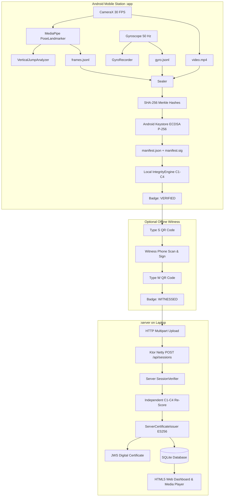

# PRAMAAN — Detailed Build & Technical Specification

> **Confidential & Local Architecture Document**  
> *Status:* Production Candidate / Master Acceptance Flow Tested  
> *Target Platforms:* Android 12+ (API 31–36) | JVM 17+ (Ktor Server)  
> *Note:* This document provides an exhaustive, brutally honest technical breakdown of the PRAMAAN system as built. It covers all implemented algorithms, hardware integrations, cryptographic protocols, user flows, and currently stubbed or postponed components.

---

## 1. Executive Summary & Core Value Proposition

**PRAMAAN** (Sanskrit for *"Proof"* or *"Evidence"*) transforms a standard, low-cost Android smartphone into an unforgeable, tamper-evident athletic testing station. 

In grassroots talent identification, self-reported scores and unverified videos are plagued by three major vectors of fraud:
1. **Video tampering & splicing:** Splicing jump frames or replacing footage.
2. **Speed manipulation:** Slowing down or speeding up footage (e.g., recorded in 60/120 fps and played at 30 fps to inflate hang-time).
3. **Collusion / Impersonation:** Testing an unverified athlete or falsifying scores without an accountable witness.

PRAMAAN solves these without cloud reliance or external timing gates using a triad of:
- **On-Device Computer Vision:** MediaPipe 33-landmark pose tracking running in real-time.
- **Hardware-Backed Cryptography:** ECDSA P-256 private keys sealed inside the phone's Android Keystore / Secure Element (StrongBox or TEE).
- **Physics-Based Integrity Auditing:** Cross-referencing ballistics (freefall gravity $g \approx 9.8\text{ m/s}^2$), multi-method measurement agreement, and hardware gyroscope stillness.

---

## 2. Brutally Honest Audit: What Is Real vs. What Is Stubbed / Postponed

To maintain engineering integrity, here is the exact, unvarnished state of every subsystem in the repository:

| Feature / Subsystem | Status | Implementation Details / Limitations |
| :--- | :--- | :--- |
| **Vertical Jump Scoring** | **100% REAL** | Implemented in `VerticalJumpAnalyzer.kt`. Computes takeoff/landing frame timestamps, flight-time jump height ($h = \frac{1}{8}gt^2$), ankle/hip pixel displacement height, and countermovement dip detection. |
| **Sit-Up Scoring** | **100% REAL** | Implemented in `SitUpAnalyzer.kt`. Detects shoulder-hip-knee angular flexion ($>140^\circ$ flat, $<55^\circ$ chest-to-knees). Computes cadence and repetition count. |
| **Other Tests (Shuttle Run, Plank, Broad Jump)** | **STUBBED (Enum Only)** | Present in `TestType` enum and UI catalog cards as "Coming Soon", but no computer vision analyzer is written for them yet. |
| **Hardware Keystore Signing (C1)** | **100% REAL** | `DeviceKey.kt` generates non-exportable ECDSA P-256 keys inside Android Keystore (`KeyGenParameterSpec`). Manifest is canonically formatted (RFC 8785) and signed with `SHA256withECDSA`. |
| **Hardware Attestation Certificate Chaining** | **POSTPONED / LOCAL** | Device keys are generated and stored in hardware Keystore, but remote attestation chaining (validating Google Root CA certificate chain for Keymaster/StrongBox) is not queried over the network. Verification relies on device public key binding. |
| **Freefall Gravity Check (C2)** | **100% REAL** | `ParabolaFit.kt` performs quadratic polynomial regression ($y(t) = at^2 + bt + c$) on hip/ankle trajectories during airborne phases. Acceleration is extracted as $g = -2a$ and validated against $g \in [7.5, 12.0]\text{ m/s}^2$. |
| **Two-Method Height Agreement (C3)** | **100% REAL** | Cross-validates flight-time ballistics ($h_{flight}$) with pixel displacement converted to centimeters via the athlete's measured standing height ($h_{disp}$). Fails if $|\Delta h| > 10\text{ cm}$. |
| **Camera Steadiness Check (C4)** | **100% REAL** | `GyroRecorder.kt` captures hardware gyroscope samples at 50 Hz. Fails if root-mean-square (RMS) angular velocity exceeds $0.15\text{ rad/s}$ during the jump. |
| **Pre-Flight Spatial Gate (Screen 2)** | **POSTPONED / PASSIVE** | UI displays visual guidance (3m marker, gyro levelness dot, athlete profile), but strict gatekeeper blocking (requiring 3 seconds of still pose before enabling the start button) is postponed to keep the flow fast and testable. |
| **Offline Witness Co-Signing** | **100% REAL** | `WitnessScreen.kt` & `CoSignScreen.kt`. Primary phone encodes session hash into an offline Type S QR code. A second phone signs it using an ECDSA key and displays a Type W QR code. Primary phone scans back to produce `witness.json` and award the `WITNESSED` badge. |
| **Central Server & Dashboard** | **100% REAL** | Ktor Netty server on port 8080. SQLite database with Exposed ORM. Re-calculates hashes, checks ECDSA signature, re-scores frames, and issues compact ES256 JWS digital certificates. |
| **Server Pairing via QR Code** | **100% REAL** | Web dashboard generates an in-line SVG QR code encoding the laptop's LAN IP (`http://<ip>:8080`). Mobile app scans it via camera and tests health via `GET /api/health`. |
| **Tamper Simulation Demo** | **100% REAL** | `TamperSimulator.kt`. Flips a single byte in `video.mp4` to demonstrate instant hash failure ($C_1$ drop from `VERIFIED` to `TAMPERED`). |
| **Authentication & Multi-Tenancy** | **DELIBERATELY EXCLUDED** | Per project rules (`AGENTS.md`), no user auth, no login screens, no background workers, and no external clouds exist. |

---

## 3. High-Level System Architecture

The project is structured as a three-tier decoupled Gradle monorepo:

```
Pramaan/
├── :core       --> Pure Kotlin/JVM domain library (zero Android dependencies, zero system clock)
├── :app        --> Android 12+ application (Jetpack Compose, CameraX, MediaPipe, Room DB)
└── :server     --> Standalone JVM verification authority (Ktor, Netty, SQLite, Exposed, ZXing)
```



---

## 4. Deep Technical Pipeline

### 4.1. Core Module (`:core`) — Deterministic Physics & Cryptography

Per user rules, `:core` has **no `android.*` imports** and **no system clock**. Time is always derived from monotonic frame timestamps ($t_{\text{frame}}$).

#### A. Canonical JSON Serialization (RFC 8785)
Cryptographic signatures fail if two JSON serializers order object keys differently or format whitespace inconsistently.  
`CanonicalJson.kt` implements a strict recursive canonicalizer:
- Keys are sorted lexicographically by Unicode code points.
- Whitespace between separators is completely stripped (`:` and `,`).
- Floats and doubles format predictably without trailing zeroes or exponential notation where appropriate.
- Canonical UTF-8 bytes are passed directly into the SHA-256 digest engine.

#### B. The Four Integrity Checks (C1 – C4)
The `IntegrityEngine.kt` evaluates four sequential checks:

1. **Check 1: Cryptographic Hardware Seal ($C_1$)**
   - Hashes of all payload files (`video.mp4`, `frames.jsonl`, `gyro.jsonl`) are recomputed and compared against `manifest.fileHashes`.
   - The device signature `manifest.sig` is converted from IEEE P1363 raw $(r, s)$ format to DER encoding and verified against the public key using standard ECDSA with SHA-256.
   - **Pass:** All hashes match and signature is valid.
   - **Fail:** If a single bit in the video or frame log is altered, $C_1$ fails, permanently marking the session `TAMPERED`.

2. **Check 2: Parabolic Gravity Agreement ($C_2$)**
   - Validates that the athlete was subjected to standard planetary gravity during the flight phase.
   - Takes all apex landmark samples between takeoff and landing and performs quadratic regression:
     $$y(t) = a t^2 + b t + c$$
   - Downward acceleration is computed as:
     $$g_{\text{meas}} = -2a \cdot S_{\text{scale}}$$
     *(where $S_{\text{scale}}$ is the pixel-to-meter body ratio).*
   - **Pass:** $7.5\text{ m/s}^2 \le g_{\text{meas}} \le 12.0\text{ m/s}^2$.
   - **Cheat Detection:** If a slow-motion video (e.g., recorded at 60 fps and played at 30 fps) is uploaded, $g_{\text{meas}}$ drops to $\approx 2.45\text{ m/s}^2$, triggering an automatic `FLAGGED` badge.

3. **Check 3: Dual-Method Measurement Concordance ($C_3$)**
   - Jump height is calculated via two fundamentally independent physical methodologies:
     1. **Kinematic Flight Time:** $h_{\text{time}} = \frac{1}{8} g (\Delta t)^2$
     2. **Optical Displacement:** $h_{\text{disp}} = (y_{\text{apex}} - y_{\text{standing}}) \cdot S_{\text{scale}}$
   - **Pass:** $|h_{\text{time}} - h_{\text{disp}}| \le 10\text{ cm}$.
   - **Cheat Detection:** An athlete holding their legs tucked in mid-air to artificially delay landing will create a massive discrepancy between flight time and true vertical hip travel.

4. **Check 4: Tripod / Camera Steadiness ($C_4$)**
   - Inspects `gyro.jsonl` over the duration of the attempt.
   - Computes the root-mean-square angular velocity:
     $$\text{RMS} = \sqrt{\frac{1}{N} \sum_{i=1}^N (\omega_{x,i}^2 + \omega_{y,i}^2 + \omega_{z,i}^2)}$$
   - **Pass:** $\text{RMS} < 0.15\text{ rad/s}$.
   - **Cheat Detection:** If a human handheld the phone, camera panning will distort optical velocity vectors.

---

### 4.2. Mobile Station (`:app`) — Native Android Implementation

#### A. Android Keystore Hardware Seal
- Private keys never leave the hardware. `DeviceKey.kt` creates a key pair using `KeyGenParameterSpec`:
  - Algorithm: `EC` (curve `secp256r1` / NIST P-256)
  - Purposes: `PURPOSE_SIGN`
  - Digest: `SHA-256`
- The public key is exported as an uncompressed ANSI X9.63 / X.509 format and stored in the manifest header.

#### B. CameraX & MediaPipe Pose Tracking Pipeline
- **CameraX 1.4:** Uses `PreviewView` configured with `ScaleType.FIT_CENTER` to prevent coordinate warping between camera sensor coordinates and display coordinates.
- **MediaPipe PoseLandmarker (Lite):** Uses `pose_landmarker_lite.task` running in `LIVE_STREAM` mode. Delivers 33 full-body landmarks (normalized coordinates $[0.0, 1.0]$, visibility, and presence).
- **Asynchronous Finalization Synchronization:**
  - In CameraX, `activeRecording.stop()` is asynchronous. Calling file sealing immediately would hash an incomplete MP4.
  - `CameraController.kt` implements `suspend fun stopAndAwaitFinalize(timeoutMs: Long)` using a Kotlin coroutine `CompletableDeferred<Unit>`. It listens for `VideoRecordEvent.Finalize` before relinquishing control to `Sealer.kt`.
- **Timestamp Collision Guard:**
  - MediaPipe `detectAsync` requires strictly increasing timestamps.
  - `PoseEngine.kt` uses a `ConcurrentHashMap<Long, Long>` mapping camera frame time to monotonically increasing sequence IDs to guarantee no dropped frames or thread crashes.

#### C. Runtime Permission Shield (`CameraPermissionGate.kt`)
- Handles Android 6+ runtime permission requests (`Manifest.permission.CAMERA`).
- Displays a branded setup card if permission is denied, and provides direct intent redirection to `ACTION_APPLICATION_DETAILS_SETTINGS` if permanently denied.

#### D. Offline Witness Protocol
- **Type S QR Code (Station):**
  ```
  PRAMAAN:S:<sessionId>:<athleteId>:<test>:<best>:<manifestSha256>:<timestamp>
  ```
- **Type W QR Code (Witness):**
  ```
  PRAMAAN:W:<sessionId>:<witnessShortId>:<witnessEcdsaSignature>
  ```
- Co-signing requires no internet, Wi-Fi, or Bluetooth. Optical scanning between two phone screens binds the witness's hardware key to the session hash.

---

### 4.3. Central Verification Authority (`:server`)

#### A. Ktor Netty Server & Endpoints
- **`GET /api/health`:** Fast diagnostic endpoint returning `@Serializable HealthStatusResponse`.
- **`GET /`:** Server-side rendered HTML5 dashboard displaying active sessions, audit metrics, video player, and the pairing QR code.
- **`POST /api/sessions`:** Multipart upload endpoint receiving:
  - `manifest.json` (canonical metadata)
  - `manifest.sig` (device ECDSA signature)
  - `frames.jsonl` (30 fps MediaPipe 33-landmark coordinate dump)
  - `gyro.jsonl` (50 Hz hardware gyro log)
  - `video.mp4` (H.264 camera video)
  - `witness.json` (optional witness attestation)
- **`GET /v/{jws}`:** Public standalone digital certificate verification page.
- **`GET /media/{id}/video.mp4`:** Direct streaming endpoint for web dashboard video playback.

#### B. Cryptographic Certificates (ES256 JWS)
- The server maintains its own ECDSA P-256 key pair (`server_key.json`).
- If an uploaded session passes all checks ($C_1$ through $C_4$), the server signs an **RFC 7515 JSON Web Signature (JWS)** token asserting:
  ```json
  {
    "iss": "PRAMAAN_CENTRAL_AUTHORITY",
    "sub": "ATH-DEMO-01",
    "session_id": "ses_1730000000_abcd",
    "test": "VERTICAL_JUMP",
    "score": 48.2,
    "unit": "cm",
    "badge": "WITNESSED",
    "sha256": "3a8f...b7e1",
    "iat": 1730000010
  }
  ```

---

## 5. End-to-End User Operational Flow

Here is the exact journey from cold launch to verified certificate:

```
[1. Home Screen]
       │
       ▼ Tap "Vertical Jump"
[2. Test Setup Screen] (Screen 2)
       │  • Selects athlete (defaults to Manpreet Kaur / ATH-DEMO-01)
       │  • Shows 3m Zone Guidance & Gyroscope steadiness indicator
       ▼ Tap "Begin Test: Attempt 1"
[3. Live Recording Screen] (Screen 3)
       │  • CameraPermissionGate requests camera access if first run
       │  • Camera preview binds at 30 FPS FIT_CENTER
       │  • Real-time skeleton overlay draws 33 joints
       │  • Live HUD displays estimated height and FPS
       │  • Athlete jumps
       ▼ Tap "Stop Test & Seal"
       │  • CameraController awaits VideoRecordEvent.Finalize
       │  • Sealer hashes video.mp4, frames.jsonl, gyro.jsonl
       │  • Android Keystore signs canonical manifest
       │  • LocalVerifier audits C1, C2, C3, C4
       ▼ Transition
[4. Official Result Screen] (Screen 4)
       │  • Displays Verified Metric (e.g. 48.2 cm)
       │  • Displays Badge: VERIFIED
       │  • Expandable sheet displays C1-C4 checklist
       │  • (Demo Feature: "Tamper Demo" button corrupts video to prove C1 fails)
       ▼ (Optional) Tap "Witness Co-Sign"
[5. Witness Screen] (Screen 5)
       │  • Shows Type S QR Code
       │  • Witness phone scans Type S, co-signs, and shows Type W QR Code
       │  • Primary phone scans Type W QR
       │  • Badge elevates to WITNESSED
       ▼ Tap "Upload to Central Server" (or navigate to Sync tab)
[6. Central Server Sync Screen]
       │  • Tap "Scan Server QR" -> Scans pairing QR from laptop screen
       │  • Tap "Test Connection" -> Verifies GET /api/health (Green check)
       │  • Tap "Sync" -> Multipart upload over Wi-Fi
       ▼
[7. Laptop Web Dashboard]
          • Server verifies hashes, signature, and re-runs physics
          • Session appears in dashboard table
          • Issues verifiable ES256 JWS certificate
          • Embedded video player allows instant video playback
```

---

## 6. Known Limitations & Roadmap for Production

1. **Hardware Root-of-Trust Chaining:** Currently, public keys are self-generated per installation in Android Keystore. Production deployment should send the Keystore certificate chain (`KeyStore.getCertificateChain`) to Google Attestation servers to guarantee the key was generated on genuine, un-rooted Android hardware.
2. **Pose Gating in Screen 2:** To prioritize end-to-end recording and sync tests, strict pre-flight gating (holding a 3-second T-pose in the box before allowing the test to start) is passive rather than enforced.
3. **Additional Tests:** Sit-ups and Vertical Jumps are fully coded. Shuttle run, plank, and broad jump require their respective pose state machines to be implemented in `:core/scoring/`.
4. **Single-Device Camera Resolution:** MediaPipe inference on cheap hardware operates optimally at 480p/720p. 1080p60 introduces thermal throttling on budget devices (e.g., Helio G85 or Snapdragon 680).
