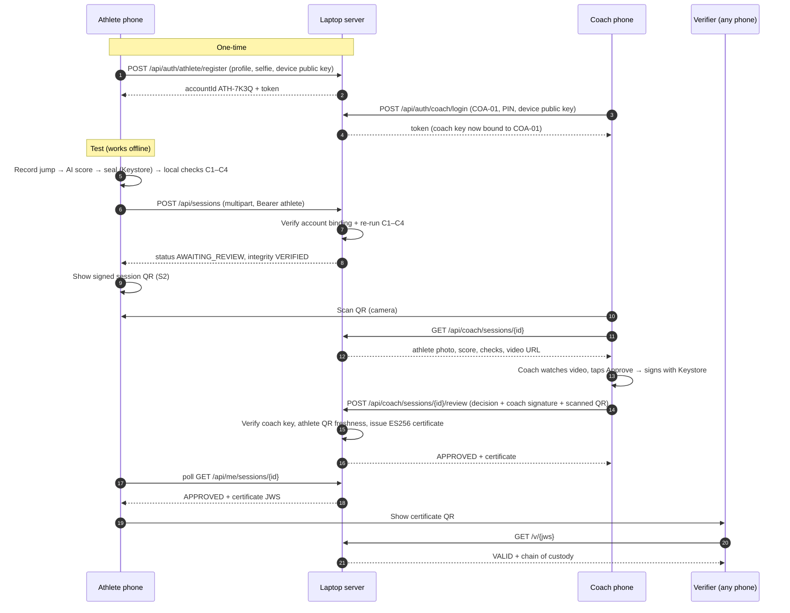
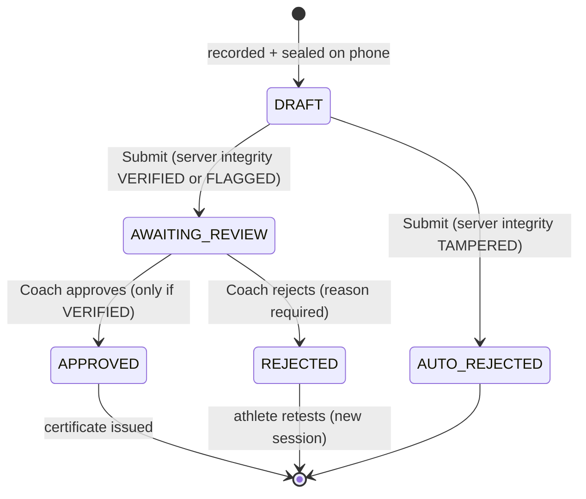
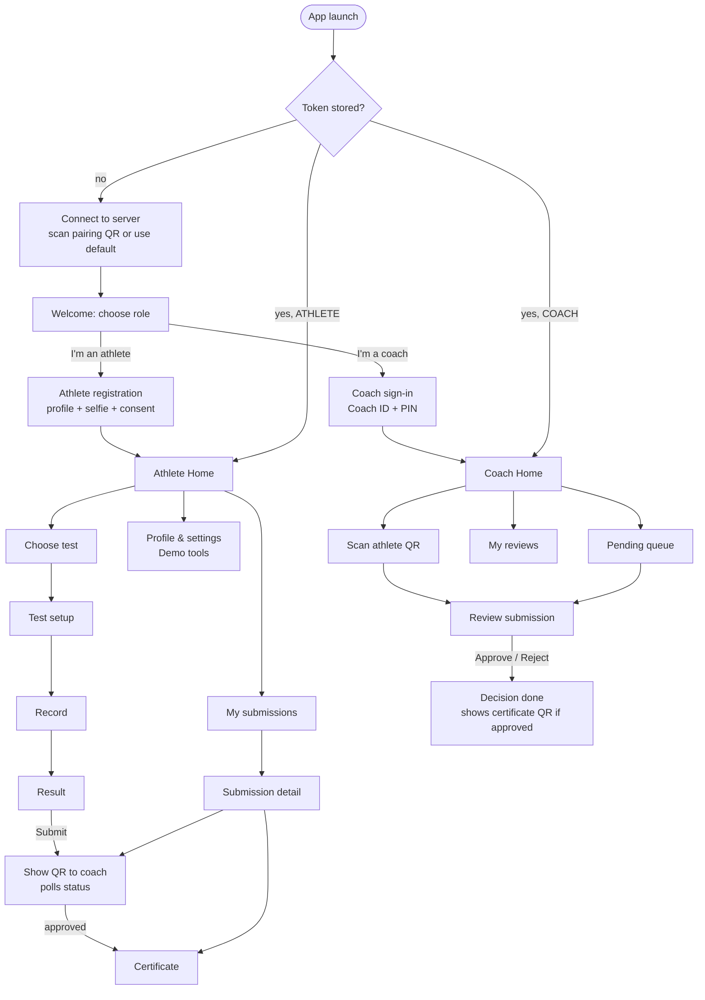

# PRAMAAN — Role-Based Workflow Spec (Athlete ↔ Coach ↔ Verifier)

> **Purpose:** Turn the current single-flow prototype into a clear two-role product: athletes **register**, coaches **sign in**, athletes record and submit tests, coaches review and sign them (in person via QR), and anyone can verify the resulting certificate.
> **Audience:** The team and the coding agents building it.
> **Level:** Hackathon prototype. Simple, working, demonstrable on 2 phones + 1 laptop. Not production.
> **Builds on:** `Build_Description.md` (current state) and the PRAMAAN Hackathon PRD.

---

## 0. TL;DR

| What | Decision |
|---|---|
| Roles | **Athlete** (self-registers on the phone), **Coach** (signs in with a Coach ID + PIN created by the organiser), **Organiser** (laptop dashboard), **Verifier** (anyone with a certificate QR, no account) |
| Login model | **Your phone is your login.** On register/sign-in, the phone's existing Keystore key is bound to the account on the server; the server returns a bearer token. No passwords for athletes, no email, no OTP. |
| Database | The existing **server SQLite** gets 3 new tables (`accounts`, `tokens`, `session_events`) and extra columns on `sessions`. The phone caches the profile + token in DataStore. |
| Athlete flow | Register → Home → Take test → Result → **Submit** → **Show QR to coach** → status flips to **Approved** → Certificate QR |
| Coach flow | Sign in → Home (pending queue) → **Scan athlete QR** → Review (video, AI score, integrity checks, athlete photo) → **Approve / Reject** (signed with coach's Keystore key) |
| Verifier flow | Scan certificate QR → `/v/{jws}` page → **Valid** + full chain of custody |
| Certificate rule | Issued only when **server integrity = VERIFIED** *and* **coach decision = APPROVED** |
| Network | Recording and QR display work offline. Register, submit and review need the laptop server on the same hotspot (true for the demo). Offline co-sign is kept as an optional fallback. |
| Effort | ~4 working days on top of the current build |

---

## 1. Where the build stands today (tally with the PRD)

### 1.1 Pillar-by-pillar

| PRD pillar / item | Built? | Notes from `Build_Description.md` | Gap for the role workflow |
|---|---|---|---|
| **Score:** vertical jump (2 methods) | ✅ Real | `VerticalJumpAnalyzer.kt`, flight time + displacement, countermovement detection | None |
| **Score:** sit-ups | ✅ Real | `SitUpAnalyzer.kt` (>140° flat, <55° up) | None |
| Live skeleton overlay | ✅ Real | CameraX 1.4 + MediaPipe Lite, `FIT_CENTER`, timestamp guard | None |
| Other tests | ⏸ Stubbed ("Coming soon") | Shuttle, plank, broad jump | Keep hidden or "Coming soon"; not part of this work |
| **Seal:** Keystore ECDSA signing (C1) | ✅ Real | `DeviceKey.kt`, RFC 8785 canonical manifest, `SHA256withECDSA` | **Reuse this key as the account identity** |
| Gravity check (C2) | ✅ Real | `ParabolaFit.kt`, pass band 7.5–12.0 m/s² | None |
| Two-method agreement (C3) | ✅ Real | Fails if |Δh| > 10 cm | None |
| Camera steady (C4) | ✅ Real | Gyro 50 Hz, RMS < 0.15 rad/s | None |
| Tamper simulation | ✅ Real | `TamperSimulator.kt` flips a byte | Move into athlete "Demo tools" |
| Import video (slowed-clip cheat) | ✅ (per PRD) | Not explicitly listed in the build doc; confirm it exists | Move into athlete "Demo tools" |
| **Share:** offline witness co-sign | ✅ Real | Type S / Type W QRs, `WitnessScreen.kt`, `CoSignScreen.kt` | **Witness becomes the Coach**; generic witness mode removed from athlete UI |
| Server + dashboard | ✅ Real | Ktor + SQLite + Exposed, re-verify, ES256 JWS, video streaming | Add accounts, auth, review endpoints, status |
| Server pairing by QR | ✅ Real | Dashboard shows LAN URL QR; app checks `/api/health` | Move to the first-launch screen |
| Certificate verify page `/v/{jws}` | ✅ Real | Public page | Add athlete + coach + chain of custody |
| Accounts / roles / auth | ❌ Deliberately excluded | `AGENTS.md` forbids auth | **This spec adds it** (update `AGENTS.md`, §12) |
| Pre-flight gating | ⏸ Passive | Guidance only | Leave as is |
| Hardware attestation chain | ⏸ Postponed | Local key binding only | Leave as is |

### 1.2 What is causing the confusion

1. **No identity.** Tests run against a hardcoded default athlete (`Manpreet Kaur / ATH-DEMO-01`), so there is no "my tests" vs "someone else's tests".
2. **One phone does everything.** Recording, witness mode, sync, server pairing and tamper demo all sit in the same app with no role boundary, so on stage it is unclear who is doing what.
3. **Witness is anonymous.** The co-signing phone is "some phone with a key", not a known coach, so the signature proves presence but not authority.
4. **Sync is a separate chore.** Upload is a manual tab, disconnected from the result the athlete just recorded.
5. **No status.** A result is either local or synced; there is no "waiting for coach", "approved", "rejected".

### 1.3 Small inconsistencies to note (no action needed for the demo)

- Thresholds differ from the PRD (C2 band 7.5–12.0 vs 7.31–12.31; C3 10 cm vs max(4 cm, 20%); C4 0.15 vs 0.05 rad/s). The built values are fine for a demo; keep them.
- The doc's header says "Production Candidate"; in practice it is a working prototype. Use "prototype" in the pitch.
- The architecture diagram mentions "Merkle hashes"; implementation is plain SHA-256 per file. Use "SHA-256 file hashes" in the pitch.

---

## 2. Target system at a glance

### 2.1 Actors

| Actor | Where | Account | Can do |
|---|---|---|---|
| **Athlete** | Own Android phone | Self-registered (`ATH-XXXX`) | Record tests, see AI score, submit, show QR, see status, get certificate |
| **Coach** | Own Android phone | Created by organiser, signs in with Coach ID + PIN (`COA-XX`) | See pending submissions, scan athlete QR, watch video, approve/reject with a hardware signature |
| **Organiser** | Laptop browser (server dashboard) | Admin password (env var) | Create coaches, see all athletes/submissions, show pairing QR |
| **Verifier** | Any phone camera / browser | None | Open certificate link and see Valid/Invalid + chain of custody |

### 2.2 Two-axis status (this is the key simplification)

Every submission has **two independent fields**:

| Field | Set by | Values |
|---|---|---|
| `integrity` | Phone, then re-computed by server (C1–C4) | `VERIFIED`, `FLAGGED`, `TAMPERED`, `UNSEALED` (imported video) |
| `status` | Workflow | `DRAFT` (local only), `AWAITING_REVIEW`, `APPROVED`, `REJECTED`, `AUTO_REJECTED` |

**Certificate = `integrity == VERIFIED` AND `status == APPROVED`.**
The old `WITNESSED` badge is replaced by **"Coach Verified"** on the certificate.

### 2.3 End-to-end sequence



### 2.4 Submission lifecycle



---

## 3. Key design decisions (and why)

### D1. "Your phone is your login" (no passwords for athletes)
- The app already creates a non-exportable ECDSA P-256 key in Android Keystore (`DeviceKey.kt`). Registration sends its **public key**; the server stores it on the account.
- The server also returns a random **bearer token** for API calls (simplest possible auth in Ktor). The token is stored in DataStore.
- Every sealed manifest already contains the device public key. The server checks **manifest key == account key**, so a submission must be recorded on the athlete's own registered phone. That is a free, strong trust point for the pitch.
- Limitation (accepted): one account per phone; reinstalling the app = new key = register again.

### D2. Coaches are created by the organiser, then sign in
- Anyone can register as an athlete, but only vetted people can authorise tests. The organiser creates coaches on the laptop dashboard (or via a seed file). Each gets a **Coach ID** (`COA-01`) and a **4–6 digit PIN**.
- On sign-in, the coach's phone key is bound to that coach account (replacing any previous key). From then on, the coach's approval is a **hardware signature traceable to a named coach**.

### D3. Submit first, then coach scans (online-first review)
- Uploading before the coach scans lets the coach **watch the video and see the AI checks on their own phone**. That is real "evaluation", not blind signing.
- The athlete's QR is **signed by the athlete's key and time-stamped**, so when the coach scans it, the server can prove the review happened **in person** (`method = IN_PERSON_QR`). Reviews from the queue without scanning are recorded as `REMOTE` and shown as such on the certificate.
- The old offline two-QR co-sign stays in the codebase as an **optional fallback** (§9), not on the main path.

### D4. Coach cannot approve a flagged or tampered result
- `FLAGGED`: Approve button disabled; coach can only Reject ("Retest needed") with the server's reason shown. Keeps the logic simple and the story clean: "AI catches the cheat, the coach confirms the human side."
- `TAMPERED`: server auto-rejects at upload; never reaches the coach queue.

### D5. Keep everything in the existing three modules
- No new services, no Firebase, no cloud. Ktor + SQLite + Exposed on the laptop, Room/DataStore on the phone. Same hotspot for all devices.

---

## 4. Data model

### 4.1 Server (SQLite, Exposed)

```sql
-- NEW: one row per person (athlete or coach)
CREATE TABLE accounts (
  id              TEXT PRIMARY KEY,          -- 'ATH-7K3Q' or 'COA-01'
  role            TEXT NOT NULL,             -- 'ATHLETE' | 'COACH'
  name            TEXT NOT NULL,
  dob             TEXT,                      -- 'YYYY-MM-DD' (athletes)
  sex             TEXT,                      -- 'F' | 'M' | 'X'
  height_cm       REAL,                      -- athletes, used for scale
  weight_kg       REAL,
  district        TEXT,
  phone           TEXT,                      -- optional
  guardian_consent INTEGER DEFAULT 0,        -- 1 if under 18 and ticked
  photo_path      TEXT,                      -- athlete selfie (256px JPEG)
  pin_hash        TEXT,                      -- coaches only (SHA-256 of salt+PIN is fine for a demo)
  pin_salt        TEXT,
  device_pubkey   TEXT,                      -- base64url SubjectPublicKeyInfo, bound at register/login
  created_at      INTEGER NOT NULL
);

-- NEW: bearer tokens (store only the hash)
CREATE TABLE tokens (
  token_hash  TEXT PRIMARY KEY,
  account_id  TEXT NOT NULL REFERENCES accounts(id),
  created_at  INTEGER NOT NULL
);

-- EXISTING sessions table: ADD these columns
ALTER TABLE sessions ADD COLUMN athlete_id      TEXT REFERENCES accounts(id);
ALTER TABLE sessions ADD COLUMN status          TEXT NOT NULL DEFAULT 'AWAITING_REVIEW';
ALTER TABLE sessions ADD COLUMN integrity       TEXT;          -- server-computed badge
ALTER TABLE sessions ADD COLUMN integrity_json  TEXT;          -- C1–C4 results with values
ALTER TABLE sessions ADD COLUMN manifest_sha256 TEXT;
ALTER TABLE sessions ADD COLUMN submitted_at    INTEGER;
ALTER TABLE sessions ADD COLUMN reviewed_by     TEXT REFERENCES accounts(id);
ALTER TABLE sessions ADD COLUMN reviewed_at     INTEGER;
ALTER TABLE sessions ADD COLUMN review_method   TEXT;          -- 'IN_PERSON_QR' | 'REMOTE' | 'OFFLINE_QR'
ALTER TABLE sessions ADD COLUMN review_reason   TEXT;          -- reject reason / note
ALTER TABLE sessions ADD COLUMN coach_sig       TEXT;          -- base64url DER
ALTER TABLE sessions ADD COLUMN certificate_jws TEXT;

-- NEW: append-only timeline for the "chain of custody" view
CREATE TABLE session_events (
  id          INTEGER PRIMARY KEY AUTOINCREMENT,
  session_id  TEXT NOT NULL,
  type        TEXT NOT NULL,   -- RECORDED, SUBMITTED, SERVER_VERIFIED, QR_SCANNED, APPROVED, REJECTED, CERT_ISSUED
  actor_id    TEXT,            -- ATH-… / COA-… / SERVER
  at          INTEGER NOT NULL,
  detail      TEXT             -- small JSON
);
```

Hackathon shortcut: if migrations are a pain, delete `pramaan.db` and let Exposed `SchemaUtils.create(...)` recreate everything.

**ID generation:** `ATH-` + 4 chars from Crockford base32 (no 0/O/1/I), retry on collision. Coaches `COA-01`, `COA-02`… sequential.

**Coach seed:** `server/seed/coaches.json`, loaded on startup if the coach does not exist:

```json
[
  { "id": "COA-01", "name": "Rakesh Kumar", "district": "Ranchi", "pin": "2468" },
  { "id": "COA-02", "name": "Sunita Devi",  "district": "Howrah", "pin": "1357" }
]
```

### 4.2 Phone

**DataStore (`AuthStore`)**

| Key | Example |
|---|---|
| `serverUrl` | `http://192.168.43.10:8080` |
| `role` | `ATHLETE` / `COACH` |
| `accountId` | `ATH-7K3Q` |
| `token` | random base64url |
| `profileJson` | cached `/api/me` response (name, height, photo URL…) |

**Room `sessions` (modify existing entity)**

| Column | Purpose |
|---|---|
| `id` | session ID (already exists) |
| `ownerAccountId` | **new**, replaces athlete picker |
| `test`, `best`, `unit`, `folder`, `createdAt` | existing |
| `localIntegrity` | existing local badge (rename from `badge` if needed) |
| `status` | **new**: `DRAFT`, `AWAITING_REVIEW`, `APPROVED`, `REJECTED`, `AUTO_REJECTED` |
| `serverIntegrity` | **new** |
| `reviewedByName`, `reviewMethod`, `reviewReason` | **new** |
| `certificateJws` | existing/new |

The local `athletes` table and the athlete picker are **no longer used** (the logged-in athlete is the only athlete on that phone). Use `fallbackToDestructiveMigration()`.

---

## 5. Backend API

All JSON. Auth = `Authorization: Bearer <token>`. Errors: `{ "error": "CODE", "message": "human text" }`.

### 5.1 Auth & accounts

| Method + path | Auth | Request | Response |
|---|---|---|---|
| `GET /api/health` | — | — | existing |
| `POST /api/auth/athlete/register` | — | multipart: `profile` (JSON below) + `photo` (JPEG, optional but recommended) | `{ accountId, token, role, profile }` |
| `POST /api/auth/coach/login` | — | `{ coachId, pin, devicePublicKey }` | `{ accountId, token, role, profile }` or `401 BAD_CREDENTIALS` |
| `GET /api/me` | any | — | profile + role |
| `POST /api/auth/logout` | any | — | `204` (deletes token) |
| `GET /api/accounts/{id}/photo` | any | — | JPEG |

Athlete `profile` JSON:

```json
{
  "name": "Manpreet Kaur",
  "dob": "2011-03-14",
  "sex": "F",
  "heightCm": 152.0,
  "weightKg": 41.5,
  "district": "Ranchi",
  "phone": "",
  "guardianConsent": true,
  "devicePublicKey": "MFkwEwYHKoZIzj0CAQ…"
}
```

Validation: name, dob, sex, heightCm required; if age < 18, `guardianConsent` must be true.

### 5.2 Athlete endpoints (role = ATHLETE)

| Method + path | Purpose | Notes |
|---|---|---|
| `POST /api/sessions` | Submit a sealed session (existing multipart) | **New checks:** `manifest.athleteId == token.accountId` and `manifest.devicePublicKey == account.device_pubkey`, else `403 WRONG_DEVICE`. Then existing re-verification. Sets `integrity`, `status` (`AUTO_REJECTED` if TAMPERED, else `AWAITING_REVIEW`), logs `SUBMITTED` + `SERVER_VERIFIED`. |
| `GET /api/me/sessions` | My submissions | List: `id, test, best, unit, integrity, status, reviewedByName, submittedAt` |
| `GET /api/me/sessions/{id}` | One submission (polled) | Adds `integrityChecks[]`, `reviewReason`, `certificateJws`, `verifyUrl` |

Upload response:

```json
{
  "sessionId": "ses_1730000000_abcd",
  "status": "AWAITING_REVIEW",
  "integrity": "VERIFIED",
  "checks": [
    { "id": "C1", "name": "Seal",      "pass": true, "value": "signature ok", "limit": "exact" },
    { "id": "C2", "name": "Gravity",   "pass": true, "value": "9.6 m/s²",    "limit": "7.5–12.0" },
    { "id": "C3", "name": "Agreement", "pass": true, "value": "2.1 cm",      "limit": "≤ 10 cm" },
    { "id": "C4", "name": "Steady",    "pass": true, "value": "0.04 rad/s",  "limit": "< 0.15" }
  ]
}
```

### 5.3 Coach endpoints (role = COACH)

| Method + path | Purpose | Notes |
|---|---|---|
| `GET /api/coach/queue` | Pending submissions | All `AWAITING_REVIEW`, newest first (single organisation, no assignment logic) |
| `GET /api/coach/history` | My reviews | `reviewed_by = me` |
| `GET /api/coach/sessions/{id}` | Review detail | Athlete profile + photo URL + age, test, best, attempts, checks, integrity, status, `videoUrl` |
| `GET /api/coach/sessions/{id}/video` | Stream video | Same file as `/media/{id}/video.mp4`, but bearer-protected. ExoPlayer sends the header. |
| `POST /api/coach/sessions/{id}/review` | Approve / reject | Body below |

Review request:

```json
{
  "decision": "APPROVED",
  "method": "IN_PERSON_QR",
  "reason": null,
  "scannedQr": "PRAMAAN:S2:ses_…:3a8f…:Qm9…:1730000123456:MEUCIQ…",
  "reviewedAt": 1730000130000,
  "coachSignature": "MEYCIQ…"
}
```

Server logic for `/review`:

1. Session exists and `status == AWAITING_REVIEW`; else `409 ALREADY_REVIEWED`.
2. If `decision == APPROVED` and `integrity != VERIFIED` → `422 NOT_APPROVABLE`.
3. If `decision == REJECTED`, `reason` is required.
4. If `method == IN_PERSON_QR`: parse `scannedQr`, check it is for this session and this `manifest_sha256`, verify its signature with the **athlete's** bound key, and check `issuedAt` is within 10 minutes of `reviewedAt` → otherwise downgrade method to `REMOTE` (don't fail; keep demo forgiving) and record why.
5. Rebuild the canonical review payload (§6.2) and verify `coachSignature` with the **coach's** bound key → else `401 BAD_SIGNATURE`.
6. Update session, log `QR_SCANNED` (if in person) and `APPROVED`/`REJECTED`.
7. If approved: issue certificate (§6.3), store it, log `CERT_ISSUED`.
8. Return the updated session (same shape as athlete detail, plus `certificateJws`).

### 5.4 Public & organiser

| Path | Auth | What |
|---|---|---|
| `GET /v/{jws}` | — | Verify page (upgraded, §8.4) |
| `GET /` | Basic auth (`ADMIN_PASSWORD` env, default `pramaan`) | Dashboard: pairing QR + counts |
| `GET /submissions`, `GET /submissions/{id}` | Basic | All submissions, filter by status; detail with video, checks, timeline |
| `GET /athletes` | Basic | Registered athletes with photo |
| `GET /coaches`, `POST /coaches` | Basic | List + "Add coach" form (name, district, PIN → returns Coach ID) |

### 5.5 Ktor implementation notes

- `install(Authentication) { bearer("api") { authenticate { cred -> TokenRepo.findAccount(sha256(cred.token))?.let { AccountPrincipal(it.id, it.role) } } } }` (Ktor 3 has `bearer` built in).
- Small helper: `fun ApplicationCall.requireRole(role: Role): AccountPrincipal` → `403 FORBIDDEN_ROLE` if mismatched.
- `basic("admin")` for dashboard routes.
- Route files: `AuthRoutes.kt`, `AthleteRoutes.kt`, `CoachRoutes.kt`, `AdminRoutes.kt`, keep `SessionVerifier.kt` and `ServerCertificateIssuer.kt`, add `ReviewService.kt`, `AccountRepo.kt`, `EventLog.kt`.
- Token: 32 random bytes from `SecureRandom`, base64url; store `SHA-256(token)`.
- PIN: store `SHA-256(salt + pin)`; constant-time compare. Fine for a demo.

---

## 6. Protocols (what gets signed)

All signatures: ECDSA P-256 / SHA-256 with the phone's existing Keystore key (`DeviceKey.kt`). Encode signatures as base64url DER. Reuse the existing P1363↔DER conversion in `:core` for verification on the server.

### 6.1 Athlete session QR (new type `S2`)

Shown on the athlete's "Show to coach" screen. Plain text QR:

```
PRAMAAN:S2:<sessionId>:<manifestSha256Hex>:<nonce>:<issuedAtMs>:<athleteSigB64url>
```

- `nonce`: 12 random bytes, base64url.
- Signed message (UTF-8): `S2|<sessionId>|<manifestSha256Hex>|<nonce>|<issuedAtMs>`
- Regenerate when the screen opens (and every 5 minutes while open).
- Length ≈ 250 characters → QR version ~10, scans easily at arm's length. Render at error correction `M`, full screen width, max brightness.

### 6.2 Coach review signature

Canonical JSON (use existing `CanonicalJson.kt` in `:core` so phone and server produce identical bytes):

```json
{
  "coachId": "COA-01",
  "decision": "APPROVED",
  "manifestSha256": "3a8f…b7e1",
  "method": "IN_PERSON_QR",
  "qrSha256": "<sha256 hex of scannedQr string, or empty>",
  "reviewedAt": 1730000130000,
  "sessionId": "ses_1730000000_abcd",
  "type": "PRAMAAN_COACH_REVIEW",
  "v": 1
}
```

Add `ReviewPayload.kt` + `fun canonicalBytes()` in `:core/manifest/` so both sides share it.

### 6.3 Certificate (extend existing ES256 JWS)

```json
{
  "iss": "PRAMAAN_CENTRAL_AUTHORITY",
  "jti": "cert_01JA…",
  "iat": 1730000131,
  "sid": "ses_1730000000_abcd",
  "sha256": "3a8f…b7e1",
  "athlete": { "id": "ATH-7K3Q", "name": "Manpreet K.", "age": 15, "sex": "F" },
  "test": "VERTICAL_JUMP",
  "score": 48.2,
  "unit": "cm",
  "integrity": "VERIFIED",
  "review": { "by": "COA-01", "name": "Rakesh Kumar", "method": "IN_PERSON_QR", "at": 1730000130 },
  "recordedAt": 1730000000
}
```

Athlete name on the certificate = first name + last initial (minimal personal data for minors). Certificate QR encodes `http://<serverUrl>/v/<jws>`.

---

## 7. Android app

### 7.1 Navigation map



Implementation: one `NavHost`, three nested graphs: `onboarding`, `athlete`, `coach`. Start destination is computed from `AuthStore` in `MainActivity` before `setContent` returns (show a blank splash for that first read). Back stack is cleared when switching graphs.

### 7.2 Onboarding screens

| Screen | Content | Actions / logic |
|---|---|---|
| **Connect** | "Connect to PRAMAAN server", default URL from `BuildConfig.DEFAULT_SERVER_URL`, status dot | "Scan server QR" (reuse existing pairing scanner) → `GET /api/health` → green → Continue. Skipped automatically if the default URL is healthy. |
| **Welcome** | Logo, tagline, two big cards | **"I'm an Athlete — Register"**, **"I'm a Coach — Sign in"** |
| **Athlete registration** | Name, DOB (date picker), Sex (3 chips), Height cm, Weight kg, District (optional), Phone (optional), **Selfie** (circle preview), guardian-consent checkbox shown if age < 18 | Selfie via `ActivityResultContracts.TakePicturePreview()` → scale to 256 px → JPEG 80. Submit → multipart register → save token/role/profile → Athlete Home. Show the new **Athlete ID** in a snackbar. |
| **Coach sign-in** | Coach ID (prefilled `COA-`), PIN (numeric, masked) | Login → bind key → save → Coach Home. Error text on 401. |

### 7.3 Athlete screens

| Screen | Content | Actions |
|---|---|---|
| **Athlete Home** | Profile card (photo, name, Athlete ID, age, height); big **"Take a test"** button; test tiles (Vertical Jump, Sit-ups; others "Coming soon"); "My submissions" preview with status chips | Tap tile → Test setup; tap submission → detail |
| **Test setup** (existing Screen 2) | Same guidance UI, **athlete picker removed**; uses profile height | "Begin test" |
| **Record** (existing Screen 3) | Unchanged | "Stop & seal" |
| **Result** (existing Screen 4) | Score, attempts, local integrity badge + C1–C4 sheet. **Remove** "Witness co-sign" and "Tamper demo" buttons from here. | Primary: **"Submit for coach verification"** → upload with progress → on success go to **Show QR**. Secondary: "Save as draft". If integrity is TAMPERED/FLAGGED locally, show a warning but still allow submit (server decides). |
| **Show QR to coach** | Full-screen S2 QR, "Show this to your coach", test + score + status chip ("Waiting for coach…"), brightness forced to max, keep screen on | Polls `GET /api/me/sessions/{id}` every 3 s. On `APPROVED`: animate to green "Approved by Rakesh Kumar" + button "View certificate". On `REJECTED`: red with reason + "Retest". |
| **My submissions** | List: test, score, date, integrity chip, status chip | Pull-to-refresh (`GET /api/me/sessions`); drafts show "Submit" |
| **Submission detail** | Score, attempts, checks (server values), timeline (submitted → verified → reviewed), reviewer, reason | "Show QR to coach" (if awaiting), "View certificate" (if approved), "Submit" (if draft) |
| **Certificate** | Card: athlete name, test, score, "Coach Verified" seal, coach name, date; large certificate QR | "Share" (share image of the card) |
| **Profile & settings** | Profile, Athlete ID, server URL, "Sign out" | **Demo tools** section (toggle in settings, off by default): "Import video" (existing), "Tamper a draft" (existing `TamperSimulator` applied to a chosen draft) |

### 7.4 Coach screens

| Screen | Content | Actions |
|---|---|---|
| **Coach Home** | Header: coach name, Coach ID, "Signing key: hardware-backed"; huge **"Scan athlete QR"** button; **Pending reviews (n)** list with athlete photo, name, test, score, integrity chip; "My reviews" link | Pull-to-refresh queue every 5 s while visible |
| **Scan athlete QR** | Camera scanner (reuse ML Kit scanner from `WitnessScreen`) | Parse `PRAMAAN:S2:…` → keep raw string → open Review with `method = IN_PERSON_QR`. Unknown format → toast. |
| **Review submission** | Top: athlete photo + name + ID + age + height ("Check this is the person in front of you"). Video player (Media3 ExoPlayer, bearer header, loop). Score + attempts. Integrity card with C1–C4 values. Banner: "Scanned in person ✓" or "Remote review". | **Approve & sign** (enabled only if `integrity == VERIFIED`) → confirm dialog "I confirm I watched this athlete perform this test" → sign → POST. **Reject** → bottom sheet with reason chips ("Not the registered athlete", "Incorrect technique", "Retest needed", "Other" + text) → sign → POST. If FLAGGED, show the failing check in amber above the buttons. |
| **Decision done** | ✓ Approved / ✗ Rejected, certificate QR if approved | "Back to queue" |
| **My reviews** | List of reviewed sessions with decision | Tap → read-only review |

### 7.5 Code structure changes (app)

New/changed packages (adapt names to the actual repo):

```
app/src/main/kotlin/app/pramaan/
├── auth/            AuthStore.kt  AuthRepository.kt  Role.kt
├── api/             ApiClient.kt (Ktor client, bearer, base URL from AuthStore)
│                    dto/ AuthDtos.kt  SessionDtos.kt  ReviewDtos.kt
├── submissions/     SubmissionRepository.kt  (upload, list, poll)
├── review/          ReviewRepository.kt  ReviewSigner.kt  SessionQr.kt (build/parse S2)
├── ui/
│   ├── nav/         RootNavHost.kt  OnboardingGraph.kt  AthleteGraph.kt  CoachGraph.kt
│   ├── onboarding/  ConnectScreen.kt  WelcomeScreen.kt  AthleteRegisterScreen.kt  CoachLoginScreen.kt
│   ├── athlete/     AthleteHomeScreen.kt  SubmissionsScreen.kt  SubmissionDetailScreen.kt
│   │                ShowQrScreen.kt  CertificateScreen.kt  ProfileScreen.kt  DemoToolsScreen.kt
│   ├── coach/       CoachHomeScreen.kt  CoachScanScreen.kt  ReviewScreen.kt
│   │                DecisionDoneScreen.kt  CoachHistoryScreen.kt
│   └── components/  StatusChip.kt  IntegrityChip.kt  AthleteCard.kt  (+ existing components)
└── (existing) camera/  seal/  data/  core screens for setup/record/result
```

| Existing file | Change |
|---|---|
| `HomeScreen.kt` | Replace with role-specific homes; delete or keep as unused |
| Test setup screen | Remove athlete picker; read athlete from `AuthStore` |
| Result screen | Replace witness/tamper buttons with **Submit**; navigate to Show QR |
| `WitnessScreen.kt` | Logic reused by `CoachScanScreen` (scanner) and offline fallback (§9) |
| `CoSignScreen.kt` | Keep only for offline fallback |
| Sync screen | Remove from navigation; upload logic moves to `SubmissionRepository`; pairing scanner moves to `ConnectScreen` and Settings |
| `TamperSimulator.kt`, import | Move entry points to `DemoToolsScreen` |
| Manifest builder / `Sealer.kt` | Put `athleteId = AuthStore.accountId` and athlete height from profile into the manifest |
| Room `SessionEntity` | Add fields from §4.2, destructive migration |
| `:core` | Add `ReviewPayload.kt`; reuse `CanonicalJson`, ECDSA verify |

New dependencies (app): `androidx.datastore:datastore-preferences`, `androidx.media3:media3-exoplayer` + `media3-ui` (or `media3-ui-compose`). Everything else exists.

### 7.6 UX rules (keep the demo legible)

- Role colour accent: Athlete = blue, Coach = orange, so the audience instantly sees which phone is which. Show the role in the top bar ("Athlete · ATH-7K3Q" / "Coach · COA-01").
- One primary button per screen.
- Status chips with words + icon: `Draft` (grey), `Waiting for coach` (blue), `Approved` (green), `Rejected` (red), `Auto-rejected` (red). Integrity chips stay separate: `AI Verified`, `Flagged`, `Tampered`, `Unsealed`.
- Never show raw JSON or hashes on main screens; put them in an "Advanced" expander.

---

## 8. Server dashboard & verify page

### 8.1 Dashboard (`/`)
- Pairing QR (existing) + server URL in big text.
- Counters: athletes, coaches, awaiting review, approved, rejected/flagged.
- Auto-refresh every 5 s (existing meta refresh or small JS fetch).

### 8.2 Submissions (`/submissions`, `/submissions/{id}`)
- Table: time, athlete (photo + name + ID), test, score, integrity chip, status chip, coach.
- Detail: video, attempts, C1–C4 with values, **timeline** from `session_events`, coach signature info, certificate link.

### 8.3 Coaches & athletes
- `/coaches`: list + form "Add coach" (name, district, PIN) → shows the new Coach ID once.
- `/athletes`: list with photo, ID, age, height, number of submissions.

### 8.4 Verify page (`/v/{jws}`) — upgrade
1. Verify JWS with the server public key → big **VALID** (green) / **INVALID** (red).
2. If valid, show: athlete first name + initial, age, test, score, date.
3. **Chain of custody** (from claims + `session_events`):
   - ✓ Recorded and sealed on the athlete's registered phone (hardware key)
   - ✓ AI checks passed: seal, gravity, agreement, steadiness
   - ✓ Approved **in person** by Coach Rakesh Kumar (COA-01) at 10:32
   - ✓ Certificate issued by PRAMAAN server at 10:32
4. If the session was later deleted/rejected → show "Revoked".
No video on the public page (privacy for minors).

---

## 9. Optional: offline coach co-sign (fallback only)

Use when the athlete's phone cannot reach the server at test time.

1. Athlete records → Result → "Submit" fails (no network) → session stays `DRAFT`; athlete taps "Show QR to coach" anyway (S2 QR works offline).
2. Coach scans. Coach app tries `GET /api/coach/sessions/{id}` → 404/offline → shows "Offline review: you can't watch the video now. Only approve if you watched the athlete perform."
3. Coach approves → signs the same review payload (§6.2, `method = OFFLINE_QR`) → shows it as QR `PRAMAAN:R:<base64url(json)>:<sig>` (reuse existing Type W screen).
4. Athlete scans it → stored as `review.json` in the session folder.
5. Later, when online, athlete submits; upload includes `review.json`; server verifies coach key + session match and moves straight to `APPROVED` (if `integrity == VERIFIED`) and issues the certificate.

Build this **last** and only if time allows; the main path is §2.3.

---

## 10. Build plan (≈4 days)

### Day 1 — Server: accounts, auth, binding
- [ ] Tables + `AccountRepo`, `TokenRepo`, `EventLog`; seed coaches from `seed/coaches.json`.
- [ ] `POST /api/auth/athlete/register` (with photo), `POST /api/auth/coach/login`, `GET /api/me`, `POST /api/auth/logout`.
- [ ] Bearer auth + `requireRole`.
- [ ] Modify `POST /api/sessions`: require athlete token, check manifest athleteId + device key, set `integrity`/`status`, log events.
- [ ] `GET /api/me/sessions`, `GET /api/me/sessions/{id}`.
- [ ] Basic-auth on dashboard; `/coaches` add form; `/athletes` list.
- **Done when:** curl can register an athlete, log in a coach, and a re-uploaded old session is rejected with `WRONG_DEVICE` unless sent by the matching account.

### Day 2 — App: onboarding, roles, athlete path
- [ ] `AuthStore` (DataStore), `ApiClient` with bearer.
- [ ] Root nav with 3 graphs; Connect, Welcome, Athlete Register (selfie), Coach Login.
- [ ] Athlete Home; remove athlete picker; manifest uses logged-in athlete.
- [ ] Result → **Submit** → upload → Show QR screen (S2 QR + polling).
- [ ] My submissions + detail.
- **Done when:** Phone A registers, records a jump, submits, and sees "Waiting for coach" with a QR; the dashboard shows it as `AWAITING_REVIEW`.

### Day 3 — Coach path + review + certificate
- [ ] `:core` `ReviewPayload`; app `ReviewSigner`; `SessionQr` build/parse/verify.
- [ ] Coach endpoints: queue, history, detail, video (bearer), review.
- [ ] `ReviewService` (rules in §5.3) + certificate claims (§6.3).
- [ ] Coach Home, Scan, Review (ExoPlayer + photo + checks), Reject sheet, Decision done, History.
- [ ] Athlete Show QR flips to Approved; Certificate screen.
- **Done when:** Phone B (coach) scans Phone A's QR, approves, and Phone A shows "Approved" + certificate within ~3 s.

### Day 4 — Verifier, dashboard polish, cheat paths, hardening for stage
- [ ] Verify page with chain of custody; dashboard submissions timeline.
- [ ] Demo tools in athlete settings (import slowed clip, tamper draft); confirm FLAGGED → coach cannot approve; TAMPERED → auto-rejected.
- [ ] Role colours, status chips, empty states, error toasts ("Server not reachable").
- [ ] Run the full acceptance walkthrough (§11) three times on the real phones.
- [ ] (If time) Offline fallback §9.

Parallelisation: one person/agent on server (Day 1 + server half of Day 3/4), one on athlete app, one on coach app. Agree on DTOs (§5) on day 1 morning and put them in `:core` or a shared `dto` file.

---

## 11. End-to-end acceptance walkthrough (functional test, not a video script)

**Setup:** laptop runs `./gradlew :server:run` on a hotspot; `ADMIN_PASSWORD` set; coaches seeded. Phone A and Phone B have the same APK installed fresh.

| # | Action | Expected |
|---|---|---|
| 1 | Laptop opens `/` | Dashboard with pairing QR, 0 athletes, 2 coaches |
| 2 | Phone A: open app → Connect (scan pairing QR) | Health ✓ |
| 3 | Phone A: "I'm an Athlete" → fill profile + selfie (age 15 → consent box appears) → Register | Athlete Home shows `ATH-XXXX`; dashboard `/athletes` shows the photo |
| 4 | Phone B: open app → Connect → "I'm a Coach" → `COA-01` + PIN | Coach Home, empty queue |
| 5 | Phone B: wrong PIN | "Coach ID or PIN is incorrect" |
| 6 | Phone A: Take test → Vertical Jump → record 3 jumps → Stop & seal | Result with score + AI Verified |
| 7 | Phone A: Submit | Show QR screen, "Waiting for coach"; Phone B queue shows 1 pending within 5 s; dashboard shows `AWAITING_REVIEW` |
| 8 | Phone B: Scan athlete QR on Phone A | Review screen: Phone A's selfie + name, video plays, checks green, banner "Scanned in person ✓" |
| 9 | Phone B: Approve & sign → confirm | Decision done + certificate QR |
| 10 | Phone A (still on QR screen) | Within ~3 s flips to "Approved by Rakesh Kumar" → View certificate |
| 11 | Third phone camera scans certificate QR | Verify page: VALID + chain of custody incl. "approved in person" |
| 12 | Edit one character of the JWS in the URL | INVALID |
| 13 | Phone A: Demo tools → import slowed clip → Submit | Status Waiting for coach, integrity **Flagged** (gravity ≈ 2.4 m/s²) |
| 14 | Phone B: open it | Approve disabled, amber reason shown; Reject "Retest needed" → Phone A shows Rejected + reason |
| 15 | Phone A: record → Demo tools → tamper that draft → Submit | **Auto-rejected**, "Video changed after recording"; never appears in coach queue |
| 16 | Phone A: re-upload a session file set from another device (or edit `athleteId` in a debug build) | `403 WRONG_DEVICE` toast |
| 17 | Coach reviews from the queue without scanning | Allowed; certificate says "Remote review" |

---

## 12. Rule updates

### 12.1 `AGENTS.md` changes
- **Replace** "no user auth, no login screens" with: *"Exactly two auth paths exist: athlete self-registration and coach Coach-ID+PIN sign-in, both binding the device Keystore key. No passwords for athletes, no OAuth, no email/OTP, no third-party auth."*
- Keep: no cloud, no background workers (polling only while a screen is visible), `:core` stays pure Kotlin.
- Add: *"The certificate is issued only when server integrity is VERIFIED and a bound coach key has signed APPROVED."*
- Add: *"All signed payloads (manifest, S2 QR message, review payload) are built by shared `:core` code."*

### 12.2 Out of scope (say so if asked)
- Account recovery / multi-device athletes, coach-athlete assignment, organisations/districts as tenants, password reset, push notifications, real SMS consent, Google attestation chain, production security of tokens/PINs, other tests (shuttle, plank, broad jump).

---

## 13. Quick reference

| Item | Value |
|---|---|
| Athlete ID | `ATH-XXXX` (Crockford base32) |
| Coach ID | `COA-NN`, created by organiser, PIN 4–6 digits |
| Token | 32 random bytes, base64url, server stores SHA-256 |
| Session QR | `PRAMAAN:S2:<sid>:<manifestSha256>:<nonce>:<issuedAtMs>:<athleteSig>`, valid 10 min |
| Coach signature | ECDSA P-256 over canonical `PRAMAAN_COACH_REVIEW` JSON |
| Certificate | ES256 JWS, issued on VERIFIED + APPROVED |
| Status values | `DRAFT`, `AWAITING_REVIEW`, `APPROVED`, `REJECTED`, `AUTO_REJECTED` |
| Integrity values | `VERIFIED`, `FLAGGED`, `TAMPERED`, `UNSEALED` |
| Polling | Athlete Show-QR: 3 s; Coach queue: 5 s; Dashboard: 5 s |
