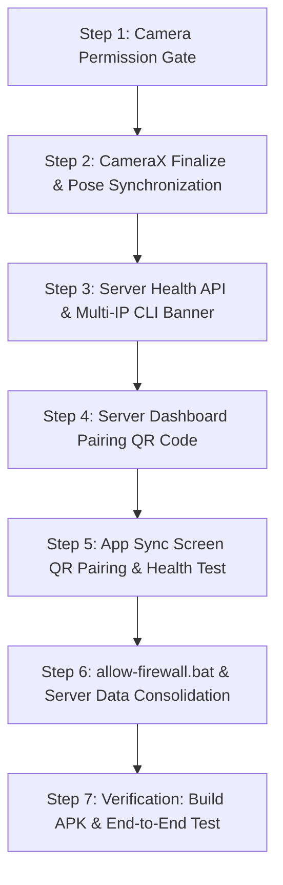

# PRAMAAN: Foolproof System Fix & Cross-Device Portability Plan

> **Status:** Draft / Awaiting User Approval (No code changes have been made yet).  
> **Target:** Seamless execution on **any** physical Android 12+ phone and **any** laptop/desktop on the same local network or personal hotspot.

---

## 1. Root Causes & Engineering Findings

### Root Cause 1: Camera Black Screen & Silent Failure
1. **Missing Runtime Permission Request:**  
   In [AndroidManifest.xml](file:///c:/Users/rio51/OneDrive/Desktop/Pramaan/app/src/main/AndroidManifest.xml#L4), `<uses-permission android:name="android.permission.CAMERA" />` is declared. However, since Android 6.0 (API 23), camera is a **dangerous runtime permission**. The code in [RecordScreen.kt](file:///c:/Users/rio51/OneDrive/Desktop/Pramaan/app/src/main/kotlin/app/pramaan/ui/screens/RecordScreen.kt) directly calls `bindCamera` without checking or requesting permissions.
   - Result: Android throws a `SecurityException`, caught by `catch (e: Exception) { e.printStackTrace() }` in `CameraController.kt`.
   - The camera preview remains pure black, zero frames reach MediaPipe, and zero video bytes are recorded.
   - The same issue silently breaks [QrScanner.kt](file:///c:/Users/rio51/OneDrive/Desktop/Pramaan/app/src/main/kotlin/app/pramaan/ui/components/QrScanner.kt) in Co-Sign and Witness screens.

2. **Asynchronous Recording Race Condition:**  
   In [RecordScreen.kt:179](file:///c:/Users/rio51/OneDrive/Desktop/Pramaan/app/src/main/kotlin/app/pramaan/ui/screens/RecordScreen.kt#L179), `container.cameraController.startRecording(videoFile)` is executed synchronously in `DisposableEffect` before CameraX has completed `bindToLifecycle` in the background thread. Because `videoCapture` is still null or unstarted, no recording occurs.

3. **Asynchronous Video Finalize Race Condition (Corrupt SHA-256):**  
   In [RecordScreen.kt:197](file:///c:/Users/rio51/OneDrive/Desktop/Pramaan/app/src/main/kotlin/app/pramaan/ui/screens/RecordScreen.kt#L197), when the user taps **Stop & Save Result**, the code calls `activeRecording.stop()` (which is asynchronous in CameraX) and *immediately* proceeds to `container.sealer.sealSession`.
   - Result: `Sealer` computes the SHA-256 hash of `video.mp4` while CameraX is still flushing the MP4 moov atom or writing file headers.
   - This leads to a mismatched hash when re-verified by the server, immediately causing the session to be stamped **TAMPERED**!

4. **Pose Timestamp Decoupling:**  
   In [PoseEngine.kt:75](file:///c:/Users/rio51/OneDrive/Desktop/Pramaan/app/src/main/kotlin/app/pramaan/camera/PoseEngine.kt#L75), `currentFrameTimestampNs` is held in a single mutable variable. Because MediaPipe `detectAsync` executes asynchronously on an internal worker thread, newer camera frames overwrite `currentFrameTimestampNs` before earlier results finish processing, corrupting flight-time calculations ($C2$ and $C3$).

---

### Root Cause 2: Server "Stuck at 91%" & Network Connection Timeout
1. **Understanding the Gradle 91% Display:**  
   `./gradlew :server:run` is a long-running daemon task. The output:
   `[DefaultDispatcher-worker-2] INFO io.ktor.server.Application -- Responding at http://127.0.0.1:8080`
   `<=---------> 91% EXECUTING`  
   means the Netty server is **100% active and running**. Gradle reports "91% EXECUTING" because the Gradle execution task does not terminate while the server process is alive.

2. **Hardcoded Emulator IP (`10.0.2.2`):**  
   In [SyncScreen.kt:74](file:///c:/Users/rio51/OneDrive/Desktop/Pramaan/app/src/main/kotlin/app/pramaan/ui/screens/SyncScreen.kt#L74), the default URL is set to `http://10.0.2.2:8080`.  
   - `10.0.2.2` is a virtual loopback IP that exists **only** inside the Android Studio emulator to reach the host computer.
   - On a physical Android phone, `10.0.2.2` is non-routable, causing the exact error observed in the screenshot: `Sync failed: Connect timeout has expired [url=http://10.0.2.2:8080/api/sessions]`.

3. **Windows Firewall Blocking Port 8080:**  
   On Windows, incoming TCP connections on port 8080 from other devices on the LAN (like your phone) are blocked by the Windows Defender Firewall by default unless an inbound rule is added.

4. **Network Isolation / Unknown LAN IP:**  
   Users running the server have to manually look up their Wi-Fi IPv4 address (`ipconfig`), which changes depending on the router, and type it into the mobile phone.

---

## 2. Comprehensive Architectural Fix Plan

### Module 1: Android Camera & Sealing Integrity (`:app`)

#### 1.1 Reusable Runtime Permission Gate (`CameraPermissionGate.kt`)
Create `app.pramaan.ui.components.CameraPermissionGate`:
- Checks `ContextCompat.checkSelfPermission(context, Manifest.permission.CAMERA)`.
- If not granted:
  - Renders a Material 3 high-contrast permission request card (Saffron branding, camera icon, clear explanation: *"PRAMAAN requires camera access for on-device AI pose estimation and video verification"*).
  - Uses `rememberLauncherForActivityResult(ActivityResultContracts.RequestPermission())`.
  - If permanently denied (shouldShowRequestPermissionRationale is false after denial): displays an **"Open App Settings"** button directing to `Settings.ACTION_APPLICATION_DETAILS_SETTINGS`.
- When granted: seamlessly renders the child content composable.
- Wraps `RecordScreen`, `TestSetupScreen` (camera views), and `QrScanner`.

#### 1.2 Camera Binding & Recording Synchronization (`CameraController.kt`)
- Modify `bindCamera` to accept an `onBound: (Boolean) -> Unit` callback and expose a `StateFlow<CameraState>` (IDLE, BOUND, ERROR).
- Refactor `startRecording`:
  - Enforce that recording cannot start until `videoCapture` is ready.
  - Return a listener ensuring the recording has officially transitioned to `VideoRecordEvent.Start`.
- Add `suspend fun stopAndAwaitFinalize(): File?`:
  - When stopping, utilizes a Kotlin `CompletableDeferred<File?>` attached to the `VideoRecordEvent` listener.
  - Suspends execution until `VideoRecordEvent.Finalize` is received from the CameraX engine.
  - Guarantees the MP4 container is fully flushed and closed before returning the file handle for hashing.

#### 1.3 Asynchronous Pose Timestamp Queue (`PoseEngine.kt`)
- Map MediaPipe's `detectAsync(mpImage, timestampMs)` accurately by tracking timestamps through a thread-safe map or timestamp payload:
  - Convert `imageProxy.imageInfo.timestamp` (nanoseconds) to `timestampMs` as key.
  - In `handleResult`, look up the exact nanosecond timestamp corresponding to `result.timestampMs()`.
  - Ensures 100% precision in flight time ($t_{flight} = t_{landing} - t_{takeoff}$) without any frame drift.

#### 1.4 Test Setup Screen (`TestSetupScreen.kt`)
- As requested in decision #2: Keep TestSetup clean and focused. The "Begin Test" button immediately navigates to `RecordScreen` with the selected athlete without blocking on pre-flight checks.

---

### Module 2: Server Pairing & Cross-Device Portability (`:server`)

#### 2.1 Multi-IP Detection & CLI Banner (`Application.kt`)
On startup, enumerate all non-loopback network interfaces (`NetworkInterface.getNetworkInterfaces()`):
- Filter for active, non-virtual IPv4 addresses (excluding VirtualBox, Hyper-V, WSL, Docker, and loopback `127.0.0.1`).
- Print a prominent CLI banner:
  ```text
  ========================================================================
     PRAMAAN SPORTS TALENT VERIFICATION SERVER (PORT 8080)
  ========================================================================
   [✓] Laptop Web Dashboard:  http://localhost:8080
   [✓] LAN Endpoint for Phone: http://192.168.1.45:8080 (or mobile hotspot)
   
   To pair your phone:
   1. Open http://localhost:8080 on your laptop browser.
   2. In the Pramaan app, go to Central Server Sync -> Tap 'Scan Server QR'.
   3. Point phone at the pairing QR on your laptop screen!
  ========================================================================
  ```

#### 2.2 Health Check API (`ApiRoutes.kt`)
Add `GET /api/health` endpoint:
- Responds with `{"status":"OK","service":"PRAMAAN_VERIFICATION_SERVER","version":"1.0"}`.
- Allows instant connection verification from both the phone app and web browser.

#### 2.3 Web Dashboard Pairing QR Code (`DashboardPages.kt`)
- Add a **"Pair Field Station"** hero card at the top of the dashboard (`GET http://localhost:8080`).
- Generates a real QR code using ZXing containing the server's LAN address (`http://<lan-ip>:8080`).
- Also displays the raw URL with a "Copy" badge for manual entry if camera scanning is not preferred.

#### 2.4 Server Data & Multipart Robustness
- Consolidate all server state into `server/data/`:
  - SQLite DB: `server/data/pramaan_server.db`
  - Keystore: `server/data/server_key.json`
  - Uploads: `server/data/uploads/`
- Set Ktor multipart receive limits to 500 MB (avoiding request truncation during HD video sync).
- Remove `server/server_key.json` from git and ensure `server/data/` is in `.gitignore`.

#### 2.5 Windows Firewall Automation (`allow-firewall.bat`)
Create a one-click batch script in the root directory:
```bat
@echo off
echo Requesting administrator privileges to allow Pramaan port 8080...
netsh advfirewall firewall add rule name="Pramaan Verification Server" dir=in action=allow protocol=TCP localport=8080
echo Inbound TCP port 8080 allowed successfully!
pause
```

#### 2.6 Server Launcher Script (`run-server.bat`)
Create a simple batch script in the root directory:
```bat
@echo off
echo Building and running Pramaan Verification Server...
gradlew.bat :server:run --no-daemon
```

---

### Module 3: Phone Sync & QR Pairing UI (`:app`)

#### 3.1 Persistent Server URL Configuration (`SyncScreen.kt` & `SharedPreferences`)
- Store `server_url` in Android `SharedPreferences`.
- If no saved URL exists, initialize as empty `""` (no bogus `10.0.2.2`).

#### 3.2 "Scan Server QR" Pairing Flow
In `SyncScreen`:
- Add a prominent **"Scan Server QR"** button next to the Server URL text field.
- Clicking it launches the camera QR scanner (wrapped in `CameraPermissionGate`).
- Scanning the server's dashboard QR instantly populates the URL (e.g., `http://192.168.43.15:8080`), saves it to preferences, and dismisses the scanner.

#### 3.3 "Test Connection" Button with Human-Readable Diagnostics
Add a **"Test Connection"** button below the URL input:
- Calls `GET /api/health` with a 3-second timeout via `SyncClient`.
- Shows instant inline status:
  - **Success:** Green banner *"✓ Connected to Pramaan Server (Latency: 45ms)"*.
  - **Failure:** Red banner with clear troubleshooting guidance:
    *"✗ Cannot reach server at <url>. Ensure both devices are on the same Wi-Fi or Hotspot, and run allow-firewall.bat on your laptop."*

#### 3.4 Upload Timeout & Progress Indication
In `SyncClient.kt`:
- Configure OkHttp client with explicit timeouts:
  - `connectTimeout(5, TimeUnit.SECONDS)`
  - `readTimeout(60, TimeUnit.SECONDS)`
  - `writeTimeout(60, TimeUnit.SECONDS)`
- Update UI to show progress during multi-megabyte video uploads.

---

## 3. Step-by-Step Implementation Sequence



1. **Step 1: Android Camera Permission Gate**  
   Implement `CameraPermissionGate.kt` and integrate it into `RecordScreen.kt` and `QrScanner.kt`.
2. **Step 2: CameraX & Pose Engine Synchronization**  
   Implement `stopAndAwaitFinalize()` in `CameraController.kt` and decouple timestamps in `PoseEngine.kt`.
3. **Step 3: Server Discovery & Health Check API**  
   Add IP enumeration and `/api/health` in `Application.kt` and `ApiRoutes.kt`.
4. **Step 4: Server Dashboard Pairing QR Code**  
   Render pairing QR on the web dashboard at `GET /` using ZXing.
5. **Step 5: App QR Pairing & Connection Diagnostics**  
   Update `SyncScreen.kt` with SharedPreferences storage, "Scan Server QR" camera scanner, and "Test Connection" check.
6. **Step 6: Firewall Helper & Launch Scripts**  
   Create `allow-firewall.bat` and `run-server.bat`, move keys to `server/data/`, update `.gitignore`.
7. **Step 7: Verification & Build**  
   Run `./gradlew test`, build APK with `./gradlew :app:assembleDebug`, and provide step-by-step instructions for physical device verification.

---

## 4. Verification & Master Acceptance Criteria

| Stage | Action | Expected Output |
| :--- | :--- | :--- |
| **1. Server Launch** | Run `run-server.bat` | Terminal displays clear LAN IP address and confirms port 8080 listening. |
| **2. Firewall Check** | Run `allow-firewall.bat` | Rule added for incoming TCP 8080. |
| **3. Web Dashboard** | Open `http://localhost:8080` | Dashboard renders session table and **Pair Field Station** QR code. |
| **4. App Launch & Permission** | Install APK and tap **Begin Test** | Android displays system permission prompt: *"Allow PRAMAAN to take pictures and record video?"*. |
| **5. Live Camera & Pose** | Grant permission | Live camera feed immediately displays with green skeleton overlay; no black screen. |
| **6. Jump Scoring & Sealing** | Perform jump & tap **Stop & Save** | Audio/visual stops, waits for MP4 finalize, signs manifest, awards **VERIFIED** badge. |
| **7. Server Pairing** | In Sync tab, tap **Scan Server QR** | Camera opens, scans laptop screen, populates LAN URL. Tap **Test Connection** $\to$ *"Connected"*. |
| **8. Session Upload** | Tap **Sync Pending Session** | Uploads multipart session; server verifies hashes & signature; issues digital certificate; dashboard updates live. |

---

*This plan is ready for execution upon your confirmation.*
